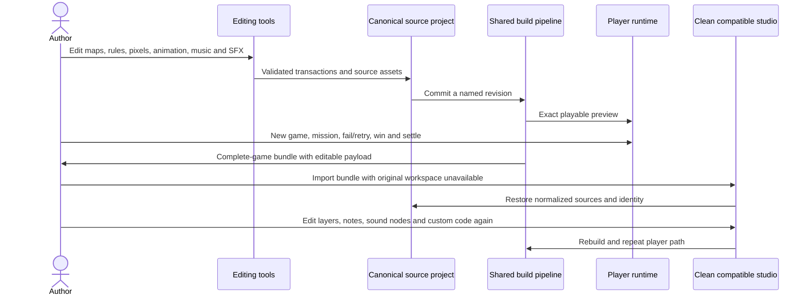

# Acceptance and complete-game round trips

[Studio index](README.md) · [Studio roadmap](STUDIO_ROADMAP.md) · [Artifacts](PROJECT_FORMAT.md) · [Audio tools](AUDIO_STUDIO.md)

These are **planned acceptance scenarios**, not tests already passing in the current game. The existing gameplay suite remains separate. Studio completion requires both editing coverage and exported-game playability.

## Golden project: one fully authored game

| Component | Required authored fixture |
| --- | --- |
| Project | New/forked stable project ID, committed revision, provenance and engine/source lock |
| Campaign | Title/new-game, short route, dialogue choice, reward and supported ending |
| Levels | Two authored maps with heights/props/deployment; at least one alternate objective |
| Rules/builds | Two distinguishable actor/job builds, abilities, status/reaction and equipment/item use |
| AI | Legal enemy role plus objective-aware scenario |
| Visuals | One layered sprite/portrait/tile set; eight-state or approved reduced animation set; pivots/directions |
| Effects | One authored projectile/contact effect and particle graph with low-motion alternative |
| Music | Original note-based phrase arranged into a looping track/stem transition |
| SFX | Original synthesized/layered impact plus miss/UI/step and a recorded/imported edited sample |
| Ambience/voice | Ambient bed/emitter and dialogue/subtitle cue with locale handling |
| UI/input | Editable menu/HUD/theme/control defaults; supported keyboard/touch/controller path |
| Custom code | One source-level behavior/extension change with build diagnostics |
| Saves | Isolated preview progress and compatible published-game backup/restore |
| Distribution | Default complete bundle plus an explicitly selected play-only build |

A fully authored fixture can be small. Its completeness is a player path and source-editing guarantee, not a large content count.

## Golden workflow

The clean import must not secretly resolve missing masters from the original editor cache or repository. Include source/dependency closure in the artifact.

## Acceptance matrix

| ID | Area | Action | Pass evidence | Requirements |
| --- | --- | --- | --- | --- |
| STAC-01 | Current-game template | Compile the existing project template and replay baseline scenarios. | Equivalent current rules, IDs, resources and RNG; no editor-only simulation. | STREQ-04, STREQ-21 |
| STAC-02 | Workspace recovery | Create/clone/checkpoint, interrupt an edit session and reopen. | One consistent reviewed project revision; player saves remain separate. | STREQ-01, STREQ-24 |
| STAC-03 | Atomic editing and undo | Apply a valid batch and an invalid/stale batch; undo/redo the accepted edit. | No partial source changes; revision and asset history match. | STREQ-01, STREQ-20 |
| STAC-04 | Level design | Resize/paint elevation/collision, place props and select corners. | Map/rule/world/input agreement and retained authored source. | STREQ-02, STREQ-12 |
| STAC-05 | Mission authoring | Edit deployment, objective, wave, phase and rewards; play fail/retry/win. | Approved counter/terminal order, no duplicate spawns or settlement. | STREQ-03 |
| STAC-06 | Rules and progression | Edit a formula/status/reaction, ability board, job unlock and support. | Preview/resolution/learning/save contracts agree. | STREQ-04, STREQ-05 |
| STAC-07 | Actors and AI | Edit an enemy/companion/summon build and AI role. | Legal deterministic behavior and stable identity/ownership. | STREQ-06 |
| STAC-08 | Economy | Edit gear, consumable, shop, recipe and loot/settlement policy. | Costs/output/ownership commit once; invalid actions preserve state. | STREQ-07 |
| STAC-09 | Campaign and quests | Create a route with choices, recruit/faction consequence and ending. | Required paths reachable; branch/restoration/settlement consistent. | STREQ-08 |
| STAC-10 | Dialogue/localization | Edit speaker/portrait/choice, codex, subtitle and locale strings. | Commit/cancel and long/missing-string diagnostics; source keys preserved. | STREQ-09 |
| STAC-11 | Pixel document | Paint/transform pixels, edit layers and indexed/RGBA palette. | Layer/cel/palette/source pixels reopen exactly; packed output remains a derivative. | STREQ-10 |
| STAC-12 | Animation | Edit frames, durations, directions, pivots, events and transitions. | Game-scale playback, interruption/down/revive and source timing agree. | STREQ-11 |
| STAC-13 | Environment source | Import/edit geometry, materials, prefabs, lights and collision. | Rendered and rule footprints agree; editable source/dependency references survive. | STREQ-12 |
| STAC-14 | VFX | Author emitters, curves, sprite/trail anchors and quality/motion alternatives. | Bounded result-driven playback, fallback and teardown. | STREQ-13 |
| STAC-15 | Music composition | Create an instrument and piano-roll phrase; edit pitch, duration and velocity. | Editable note/instrument sources survive with audible compiled result. | STREQ-14 |
| STAC-16 | Arrangement and stems | Arrange patterns, tempo/meter, automation, stems and loops. | Aligned render and transitions follow the declared sample/tick policy. | STREQ-14, STREQ-17 |
| STAC-17 | Original sound synthesis | Create a new layered SFX from noise/oscillators/samples and envelopes. | Graph/node/source layers remain editable after export/import. | STREQ-15 |
| STAC-18 | Waveform and takes | Record/import a take, trim/split/fade/reverse/normalize and loop. | Original PCM plus edit list preserved; supported codec conversion explicit. | STREQ-15, STREQ-16 |
| STAC-19 | Mixing | Route music/SFX/ambience/voice/UI buses, sends, ducking and automation. | Realtime/offline/runtime parity under the declared graph/toolchain settings. | STREQ-17 |
| STAC-20 | Audio cue binding | Bind hit/miss/footstep/UI/phase cues with variants, caps and cooldowns. | Resolved facts and deduplication correct; no combat RNG consumed. | STREQ-15, STREQ-17 |
| STAC-21 | Ambience and voice | Place an emitter/bed; bind locale voice and subtitle; mute/resume. | Loop/spatial/subtitle fallback and source editability survive. | STREQ-16, STREQ-17 |
| STAC-22 | UI and controls | Edit title/HUD/theme/input/accessibility defaults and play supported controls. | Complete new-game-to-settlement path with focus and readable feedback. | STREQ-18 |
| STAC-23 | Code extension/source | Edit a custom rule/runtime module and buildable source export. | Included API/dependency/source locks reproduce the behavior in a clean build. | STREQ-19 |
| STAC-24 | Automation parity | Repeat representative map/pixel/note/SFX/rule/UI edits through UI and API/CLI. | Equivalent project diffs, undo and diagnostics; no hidden-only edit path. | STREQ-20 |
| STAC-25 | Exact playable preview | Run asset, mission and full-game preview from a named revision/build. | Actual exported runtime semantics, isolated saves and inspectable results. | STREQ-21 |
| STAC-26 | Default complete export | Export Complete game and inspect its members/dependency report. | Playable runtime plus all editable masters/graphs/code and engine/build locks. | STREQ-23 |
| STAC-27 | Clean complete reimport | Import default bundle in a clean compatible studio with original workspace unavailable. | Source IDs/graphs/pixels/PCM/code preserved; re-edit each major domain and rebuild. | STREQ-22, STREQ-23 |
| STAC-28 | Project/pack/source transfers | Export project, selected asset pack and source; import with ID conflicts. | Lossless whole-project/source modes and explicit partial-pack remapping. | STREQ-22 |
| STAC-29 | Play-only launch | Build runtime-only and launch via local preview/root/subpath static host. | Playable without studio/backend/original repo; missing rich-source guarantee disclosed. | STREQ-23, STREQ-24 |
| STAC-30 | Save compatibility | Export/import player progress across compatible and incompatible edited builds. | Declared compatibility/migration or explicit rejection without lost progress. | STREQ-24 |
| STAC-31 | Offline/update/lifecycle | Rehearse chosen offline profile, interrupted update and background/resume. | Compatible cached build/assets/saves; graphics/audio resources recover or dispose. | STREQ-24 |
| STAC-32 | Import/build failures | Import corrupt/missing/unsupported content, codec or extension and attempt export. | Actionable diagnostics, original project intact, last valid build accurately labeled. | STREQ-22, STREQ-24 |

## Compare before and after import

| Source | Required comparison |
| --- | --- |
| Content graph | Stable IDs, references, rule parameters and approved ordering |
| Map | Dimensions, tiles/heights, props/collision, deployment and objective state definitions |
| Pixel documents | Layer/cel order, palette/index mode, exact source pixels and transparency |
| Animation | Frame identity, durations, directions, pivots, tags and bindings |
| Music | Note starts/durations/velocity, tempo/meter, instruments, arrangements and automation |
| SFX | Graph topology/parameters/seeds, original sample hashes and edit lists |
| Mix/cues | Buses/sends/processing, priorities/variants/cooldowns and event bindings |
| Code | Source files, API declarations, engine overrides, build scripts and dependency locks |
| Provenance | Source/rights metadata, processing versions and required notices |
| Runtime | Declared equivalent rule results, decoded frame/audio parity and actual player path |

Archive timestamps, nondeterministic encoded metadata and device audio output require declared normalization/tolerances. Do not hide source loss behind a successful screenshot or an audible flattened track.

## Export/editability truth table

| Input artifact | Play immediately through supported launch? | Reopen full authored sources? | Expected result |
| --- | --- | --- | --- |
| Editable project | Build first | Yes within supported schema | Validate/build before play |
| Complete game bundle | Yes | Yes | Default full-game handoff |
| Runtime-only game | Yes | No whole-project guarantee | Clearly labeled source limitations |
| Asset pack | Requires a target project | Selected sources only | Dependency/conflict mapping |
| Player-save backup | Requires compatible game | No | Restore player progress only |
| Source export | Rebuild first | Yes | Buildable developer handoff |

## Editor quality and accessibility gate

| Area | Acceptance |
| --- | --- |
| Tool navigation | Keyboard paths and visible focus for core editors, dialogs and export/import |
| Canvas alternatives | Numeric/structured controls for positions, curves, notes, layers and graph connections |
| Long operations | Progress/cancel and consistent recovery for imports, bounces and builds |
| Diagnostics | Source document/field/node, reason and next resolution step |
| Undo/history | Clear revision scope, bounded storage and no hidden player-save mutation |
| Performance | Reference hardware/scene/asset sizes; measured limits and quality profiles |
| Audio | User gesture, mute/bus controls, preview stop and suspended/background recovery |
| Corruption | Staged rejection and last valid project/build remain identifiable |
| Compatibility | Project, engine, extension, build and player-save versions are distinct |

## Milestone completion

All twenty-four requirements need at least one tooling work item and one acceptance scenario. Every export profile needs declared guarantees and coverage. The planning checker validates those links; it does not execute these future scenarios or certify the tools.

Only mark the studio release gate complete after the golden fixture passes the full workflow in a clean environment, source edits remain possible, and the supported launch/device matrix is published with evidence.

