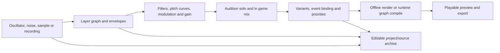
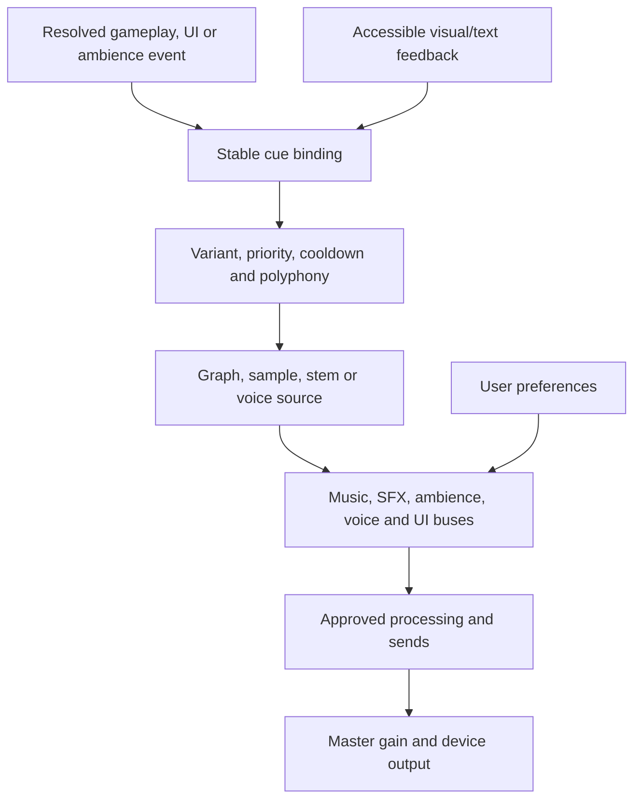
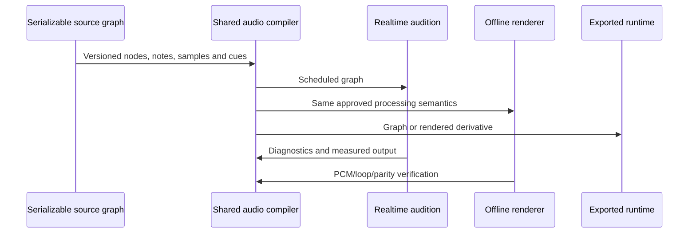

# Music, sound effects and audio studio

[Studio index](README.md) · [Authoring tools](AUTHORING_WORKFLOWS.md) · [Project format](PROJECT_FORMAT.md) · [Runtime integration](RUNTIME_BUILD_EXPORT.md)

**Planned tools, with sound effects as a first-class authoring domain.** The current AudioScore is an oscillator-based sketch and command tones. The proposed studio adds composition, synthesis, sampling, waveform editing, recording, ambience/voice, mixing and runtime cue design. Music editing alone does not satisfy this plan.

## Audio toolset

| Tool | Create/edit | Required preservation |
| --- | --- | --- |
| Instrument rack | Oscillators, noise, samples, envelopes, filters, modulation and routing | Serializable instrument graph and source samples |
| Piano roll / pattern editor | Pitch, start/duration, velocity, quantize, transpose and pattern reuse | Note/event data and instrument references |
| Arrangement timeline | Tracks, clips, markers, tempo/meter map, stems and automation | Editable arrangement, not only a rendered song |
| SFX graph editor | Layered oscillator/noise/sample sounds, pitch sweeps, modulation and transient/tail design | Graph, parameters, seeds and source recordings |
| Waveform editor | Trim/split, fades, reverse, gain, normalization, loop/crossfade and region markers | Original PCM plus non-destructive edit list |
| Sampler | Root note, key/velocity zones, loop points, envelopes and sample start | Mapping and original sample |
| Recorder | User-started microphone/device recording, take management and region assignment | Original takes, format metadata and selected edits |
| Ambience editor | Beds, stochastic one-shots, zones, emitter positions and transitions | Region/emitter graph and source assets |
| Dialogue/voice editor | Takes, speaker/locale, subtitle alignment, playback and replacement | Original recordings, selected regions and text bindings |
| Mixer | Master/music/SFX/ambience/voice/UI buses, sends, processing and ducking | Mixer graph, gain/pan and automation |
| Cue designer | Event binding, variants, priority, polyphony, cooldown and spatial rules | Stable cue IDs and routing/variation policies |
| Export/bounce | Master/stems, selected SFX, instruments/graphs and reusable packs | Editable sources plus explicit rendered derivatives |

Recording is initiated through a user-facing record control and the relevant browser/device permission. An agent can prepare the track/graph and process an existing take; the workflow does not assume unattended microphone access.

## Source and timeline model

| Contract | Proposed direction | Why it matters |
| --- | --- | --- |
| Source sample | Immutable original PCM/recording with sample rate, channel count and hash | Undo, codec changes and round trips retain source quality |
| Edit list | Trim, fades and processing described relative to source frames | Re-edit a clip instead of destructively replacing it |
| Musical time | Integer musical ticks plus tempo/meter map | Notes survive tempo changes and export/import |
| Render time | Explicit sample-frame scheduling in a declared project mix rate | Offline/realtime comparison has a stable basis |
| Candidate default | 48 kHz project mix, floating-point processing | A proposal to measure/review, not a browser/device guarantee |
| Graph | Versioned node types, parameters, ports and modulation edges | No live AudioNode objects in project JSON |
| Randomness | Local audio/render seeds separate from combat RNG | Repeatable variants without gameplay divergence |
| Build derivatives | Encoded runtime clips and compiled graph data | Can be rebuilt from source under a locked toolchain |

Tempo changes, loop boundaries, sample-rate conversion and automation interpolation need explicit contracts. Editor preview, offline render and exported playback must use the same approved graph semantics and scheduling model.

## Original SFX recipes

These are candidate starting recipes, not generated/shipped sounds. Parameters are editable and should be auditioned in the complete game mix.

| Family | Candidate layers | Editable controls | Runtime binding |
| --- | --- | --- | --- |
| Sword swing | Filtered noise sweep plus short tonal edge | Pitch curve, attack, width and tail | Approved swing/cast presentation event |
| Weapon impact | Transient click, body resonance and material sample/noise | Transient/body balance, decay and material variant | Resolved hit; no successful-hit cue on miss |
| Guard/block | Metallic body plus short muted contact | Filter, pitch, attack and guard emphasis | Approved block/protection result |
| Miss/evade | Quiet air sweep or cloth motion | Gain, pan, duration and variant | Resolved miss |
| Fire spell | Noise ignition, pitch fall and crackle tail | Noise color, envelope, density and tail | Cast/travel/contact phases as separately bound cues |
| Ice spell | Bright transient, resonant shards and brittle tail | Resonance, shard timing and filter | Frost contact/breakup |
| Lightning | Short crack, electrical noise and controlled low body | Transient, modulation and decay | Bolt/contact result |
| Healing/support | Soft oscillator chord, small bell-like transient and airy tail | Interval, envelope, tone and sustain | Heal/buff outcome |
| Footsteps | Surface-specific sample/noise plus gear/cloth layer | Surface, pace, pitch variation and distance | Cosmetic step markers during actual travel |
| Doors/props | Latch transient, mechanism body and material tail | Open/close state, size and motion envelope | Resolved interact/prop transition |
| UI | Short confirm/cancel/error/focus motifs | Duration, pitch and UI bus level | Explicit UI action, independent of combat success |
| Ambience | Looped bed plus sparse localized events | Density, zone, crossfade and seed | Region/state-driven ambience |
| Voice | Recorded/imported takes with edits and subtitles | Take/locale selection, gain, cleanup and ducking | Dialogue cue; subtitle remains available |

## SFX editing workflow

A designer must be able to create a new effect from synthesis without importing an external finished clip, and also import/record/layer source audio. Both UI and automation commands expose these operations.

## Music composition and arrangement

| Operation | Acceptance |
| --- | --- |
| Create an instrument | Save/reopen graph with oscillator/sample and envelope settings intact |
| Enter notes | Edit pitch, start, length and velocity through piano roll and typed API |
| Build patterns | Reuse, duplicate and vary a pattern without unintended source edits |
| Arrange a track | Move/split/loop clips, automate instruments/mixer and preserve tempo map |
| Add stems | Route percussion, harmony, melody and texture independently |
| Loop | Audition start/end, crossfade/tails and sample-accurate boundary policy |
| Adaptive transition | Change region/battle/boss intensity with declared musical boundaries |
| Export | Bounce master/stems and retain arrangement/notes/instruments in the project |

A rendered music file is a valid runtime derivative. It is not a substitute for the editable score/arrangement when the music was authored in the studio.

## Mixer and runtime cue routing

| Cue contract | Required behavior |
| --- | --- |
| Identity | Stable cue ID, event ID/cursor and versioned source reference |
| One-shot deduplication | A repeated snapshot/load does not replay an old impact or UI click |
| Music/ambience state | Resume the approved region/intensity state without replaying transition stings |
| Variant selection | Local audio seed and declared weights; no combat-seed consumption |
| Polyphony | Per-cue/global cap and explicit oldest/quietest/priority policy |
| Spatial behavior | Gain/pan/distance model based on presentation positions; optional occlusion policy |
| Cooldown | Named clock/boundary and grouping; no arbitrary duplicated suppression state |
| Voice | Locale selection, subtitle fallback and voice/music ducking |
| User settings | Separate bus preferences; master mute and suspended-context recovery |
| Failure | Clear diagnostic/fallback for required audio, optional-cue omission only when declared |

Current latest-action cues will need the planned event/cursor work for richer footstep, reaction, prop and phase bindings. The studio plan does not imply that event queue is already implemented.

## Realtime preview and offline render parity

Compare normalized PCM under the same project rate, graph/toolchain version and seed. Device output/resampling differences need declared tolerances. Realtime audio settings must not secretly change the offline bounce.

## Formats and adapters

| Input/output | Planned handling | Preservation/validation |
| --- | --- | --- |
| WAV/PCM | Baseline source/master import/export | Validate headers, channels, rate and frame counts |
| FLAC/lossless sources | Adapter-based decode/preserve | Keep original plus declared processing representation |
| Ogg/Opus/MP3/AAC | Supported decoder/encoder adapters per release target | Capability-test, convert explicitly and report unsupported codecs |
| MIDI | Note/tempo/instrument-mapping import/export | Review instrument/controller mapping; keep source file |
| Stems | Named track renders with alignment/loop metadata | Reassemble against arrangement with stable timing |
| Synth/SFX graph | Native project/preset format | Node/API compatibility and source dependency closure |
| Reusable audio pack | Selected graphs/samples/cues plus dependencies | Conflict mapping and provenance retained |

Required playable exports need a proven target-compatible audio path. If a requested encoder is unavailable, show the limitation and a supported export/conversion option. Do not silently ship silence or pretend a flattened recording contains recoverable note/layer data.

## Audio acceptance gate

Create a music phrase and an original layered SFX, import a recorded sample, trim/fade/loop it, automate the mixer, bind SFX to hit and miss, add an ambient bed and a dialogue/subtitle cue, then play/export/reimport. Edit notes, SFX nodes, source regions and cue bindings again in a clean studio. Verify mute, bus controls, priority/caps, suspended audio recovery and no extra combat RNG draws.

