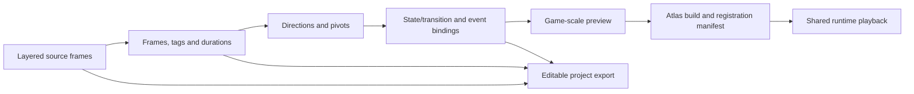

# Authoring tools and player-facing workflows

[Studio index](README.md) · [Audio](AUDIO_STUDIO.md) · [Automation](AUTOMATION_AND_EXTENSION_API.md) · [Round-trip gates](ACCEPTANCE_AND_ROUNDTRIP.md)

All tools in this document are planned. The studio must expose the same durable edits to people and automation clients, with real preview and export behavior.

## Workspace model

| Area | Proposed behavior |
| --- | --- |
| Project browser | New from blank/current-game/template, open/import, clone, recent projects and recover |
| Asset/content browser | Stable IDs, folders/tags, search, dependency/usage graph and missing-reference diagnostics |
| Main canvas | Map, pixels, timeline, waveform or node graph appropriate to selected content |
| Inspector | Typed editable fields, units/ranges, defaults, references and validation reasons |
| History | Transactional undo/redo, named checkpoints, diff and revision conflict handling |
| Playtest | Launch exact compiled project; seed/loadout/mission selection and diagnostics |
| Build/export | Profile selection, preflight report, complete-game default, output identity and import proof |
| Accessibility | Keyboard tool navigation, focus, scale, contrast and alternatives to drag-only controls |

## Tools by domain

| Tool | Edit operations | Preview/validation | Exported source |
| --- | --- | --- | --- |
| Terrain/map editor | Resize, paint elevation/terrain, brushes, flood fill, select/copy regions | Bounds, paths, camera quadrants and tile labels | Map tiles, dimensions and material references |
| Prop/prefab editor | Place/rotate/scale props, collision footprints, doors and destructibles | Visual/rule collision agreement | Prefab/material/interaction records and source geometry |
| Deployment editor | Ally/enemy/neutral/summon zones, roster caps and spawn order | Legal occupancy and stable iteration | Deployment definitions and actor references |
| Encounter/objective editor | Success/failure, counters, waves, phase triggers and rewards | Simultaneous results, blocked waves and retry | Objective/encounter graphs |
| Combat/rule editor | Formulas, shapes, range, LOS policy, statuses, reactions and difficulty | Shared preview/resolution fixtures | Rule configuration/graphs and approved extensions |
| Job/progression editor | Jobs, skill boards, JP costs, prerequisites, supports and growth | Reachability, ownership and equipment checks | Typed progression definitions |
| Actor/AI editor | Identity, stats, portraits, builds, behavior profiles and score weights | Legal-action scenarios and diagnostics | Actors and AI profiles/graphs |
| Economy editor | Gear, consumables, inventory, shops, recipes, loot and settlement | Atomic cost/output and no duplicate unique rewards | Economy/transaction definitions |
| Campaign/quest editor | Routes, flags, factions, recruitment, branch convergence and endings | Required-path reachability and checkpoint restores | Campaign/quest graphs |
| Dialogue/localization editor | Speakers, choices, conditions, codex, subtitles and string keys | Cancel/commit, overflow and locale coverage | Dialogue nodes and localized text/audio references |
| Pixel/tile editor | Brushes, eraser, selection, transforms, fills, palettes and layers | Actual game-scale silhouette/contrast | Editable layered pixel documents |
| Animation editor | Frames, cels, tags, durations, directions, pivots and transition rules | Onion skin, loop/contact/down/revive and camera review | Timeline, source frames and registration |
| VFX/particle editor | Emitters, shapes, colors, curves, trails, blending, anchors and budgets | Resolved outcomes, reduced motion and pool pressure | Editable effect graphs and source clips |
| Music composer | Notes, patterns, instruments, tempo/meter, arrangement and stems | Realtime audition, loop and adaptive transition | Notes, instruments, arrangement and automation |
| SFX designer | Oscillator/noise/sample layers, envelopes, filters and modulation | Audition at contact/miss/UI events and in mix | Synth/sample graphs and original recordings |
| Ambience/voice editor | Beds, zones, emitters, recorded/imported dialogue and subtitles | Spatial/loop/background/locale checks | Source clips, loops, placement and subtitle bindings |
| Mixer/cue editor | Buses, gain/pan, processing, ducking, variants and event binding | Polyphony, priority, mute and exact cue firing | Mixer/cue graphs |
| UI/control editor | Menus, HUD, layouts, themes, icons, fonts, bindings and settings | Full keyboard/touch/controller flow and readable targets | UI schemas, styles, bindings and defaults |
| Source/extension editor | Custom rules, runtime modules, inspectors and shader/material extensions | Compile, tests, diagnostics and preview | Buildable sources and API/dependency locks |

## Pixel-art editing contract

| Feature | Required behavior |
| --- | --- |
| Document | Named dimensions, transparent background, color mode and stable layer/cel IDs |
| Tools | Pixel brush/eraser, line/shape, flood fill, selection, clipboard, move/flip/rotate and zoom/grid |
| Palettes | RGBA and optional indexed palettes; transparent index and conversion are explicit |
| Layers | Visibility, opacity, order, grouping and non-destructive source preservation |
| Animation | Cels per frame, duplicate/reorder, duration, tags, playback and onion skin |
| Registration | Pivot/foot anchors, canvas padding, hit/attachment markers and direction |
| Tiles | Tile extraction, reusable tiles, terrain tags and edge/neighbor rule editing |
| Import | PNG/atlas and supported layered-format adapters with mapping review |
| Export | Master document plus packed/runtime derivative; never replace source with packing output |
| Automation | Batched stroke/selection/layer/frame/palette commands with undo and revision checks |

Imported flattened PNGs begin as flattened source documents; they do not magically recover an artist's missing layers. Projects created in the studio preserve layers through complete-game export/import. Existing generated sheets remain source assets until a user deliberately edits or derives a new document.

## Animation workflow

Sound/VFX markers reference resolved presentation events or approved cosmetic attachment points. Changing an animation duration does not change authoritative damage or initiative timing.

## Complete level-to-game workflow

1. Create a project from the current-game template or a blank validated template.
2. Paint a map and define heights, collision, props and deployment zones.
3. Add actors, AI roles, objective/failure rules and rewards.
4. Author jobs/abilities/economy and a short campaign/dialogue path.
5. Create or import sprites, edit frames/pivots and bind attack/cast states.
6. Add effect/particle graphs and reduced-motion alternatives.
7. Compose music, design original SFX, add ambience/voice and route the mixer/cues.
8. Configure menus, controls, accessibility defaults and localized text.
9. Validate, playtest the exact build, inspect results and make undoable edits.
10. Export Complete game; import it in a fresh workspace; edit sources and rebuild.

## Error and recovery behavior

| Situation | Expected editor behavior |
| --- | --- |
| Delete asset used by content | Show references; offer remap/cancel or a validated explicit removal |
| Resize map over occupied cells | Review affected actors/props/objectives before a commit |
| Invalid formula/graph/code | Diagnostics identify source; preserve last valid preview/build |
| Missing audio decoder/font/model adapter | Preserve source, show supported conversion/mapping route |
| Undo after playtest | Undo authoring transaction, not unrelated player progress |
| Crash during edit/import | Restore a consistent project revision or reviewed recovery candidate |
| Concurrent UI/agent edit | Reject stale revision or perform explicit reviewed merge |
| Export preflight fails | Produce an actionable report; do not label an incomplete build successful |

## Editing parity

An operation is incomplete if it works only through a hidden inspector or one UI gesture. The [automation contract](AUTOMATION_AND_EXTENSION_API.md) requires inspectable schemas, typed operations, transactions and diagnostics. The acceptance suite tests a representative edit in every domain through both a UI path and an automation path.

