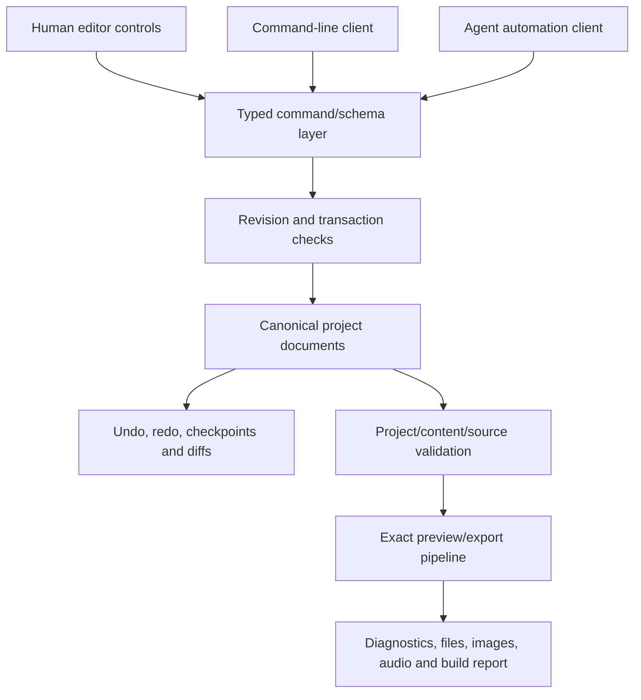

# Automation, editing transactions and extension API

[Studio index](README.md) · [Workflows](AUTHORING_WORKFLOWS.md) · [Project format](PROJECT_FORMAT.md) · [Acceptance](ACCEPTANCE_AND_ROUNDTRIP.md)

**Proposed interfaces, not tools currently available in this repo.** The studio must be editable through documented UI, CLI and agent/API operations. The same command implementation should serve all three.

## Shared editing surface



No essential editing operation should exist only as a hidden drag gesture or private component state.

## Capability contract

| Proposed operation | Result |
| --- | --- |
| describeCapabilities | Tool/domain names, schema versions, supported formats and unavailable features |
| inspectProject / listDocuments | Stable IDs, revisions, references and source/build state |
| inspectSchema | Field types, units, allowed values, defaults, constraints and extension hooks |
| beginTransaction | Expected base revision, target scope and transaction identity |
| applyCommands | Typed staged edits with per-command diagnostics |
| diffTransaction | Human/agent-readable changes and affected dependency closure |
| validateTransaction | Syntax, references, graph rules, compatibility and source constraints |
| commit / abort | Atomic accepted revision or unchanged project |
| undo / redo / checkpoint | Revision-aware authoring history with explicit storage limits |
| previewBuild / runScenario | Exact compiled revision, seed, runtime result and diagnostics |
| exportArtifact / inspectArtifact | Requested profile, included payload, hashes and actual round-trip capability |
| importArtifact | Staged inspection/mapping/review followed by an accepted transaction |

The first capability call should be enough to discover which operations can edit a map, sprite, note, sound graph or source module. Unsupported operations return an explicit capability error instead of silently approximating an edit.

## Domain command coverage

| Domain | Representative proposed commands |
| --- | --- |
| Project | create, clone, rename, setMetadata, createCheckpoint, restoreRevision |
| Map/props | resizeBoard, paintTiles, setHeight, setCollision, placePrefab, setDeploymentZone |
| Encounter | setObjectiveGraph, addWave, setBossPhase, setRewardPolicy |
| Rules/builds | setAbility, setFormula, setStatusRule, setJobBoard, setEquipment, setAIProfile |
| Campaign/text | addQuestNode, connectRoute, setChoiceCondition, setRecruitment, editLocalizedString |
| Pixels | createPixelDocument, addLayer, applyStrokeBatch, fillSelection, transformPixels, setPalette |
| Animation | addCel, reorderFrames, setDuration, setPivot, setDirection, setStateTransition |
| VFX | addEmitter, setCurve, setAnchor, setBudget, bindEffectCue |
| Music | createInstrument, addNotes, editPattern, arrangeClip, setTempoMap, automateParameter |
| SFX | createSoundGraph, addNoise/Oscillator/SampleNode, connectAudioPorts, setEnvelope, setSampleRegion |
| Ambience/voice | placeAudioEmitter, setLoopRegion, importTake, bindVoiceSubtitle, setLocaleTake |
| Mixer/cues | createBus, routeSend, setGainPan, setDucking, setVariants, bindResolvedEvent |
| UI/controls | editLayout, setThemeToken, mapInputAction, setAccessibilityDefault |
| Code | editSourceFile, createExtensionManifest, runCompile, runExtensionScenario |
| Build/export | validateProject, buildPreview, exportCompleteGame, importProject, compareRoundTrip |

## Transaction example

```json
{
  "format": "echoes-studio-command-proposal",
  "projectId": "example-authoring-project",
  "expectedRevision": 42,
  "commands": [
    {
      "kind": "map.setHeight",
      "mapId": "map-demo",
      "tile": { "x": 3, "z": 4 },
      "height": 1
    },
    {
      "kind": "audio.setEnvelope",
      "graphId": "sfx-sword-contact",
      "nodeId": "body-envelope",
      "attackMs": 3,
      "decayMs": 140
    },
    {
      "kind": "animation.setDuration",
      "clipId": "vanguard-attack",
      "frameId": "contact-frame",
      "durationMs": 90
    }
  ]
}
```

Illustrative design only. These command kinds and payloads are not accepted by the current game. A committed batch must preserve source references and expose a diff before/after validation.

| Transaction rule | Required behavior |
| --- | --- |
| Revision | Stale expectedRevision is rejected or sent to an explicit merge flow |
| Staging | Changes are isolated until commit |
| Atomicity | Invalid batch does not leave a half-painted map or partially edited cue graph |
| IDs | Create/clone/remap behavior is explicit and references update consistently |
| Undo | Restore the authored documents/assets affected by the transaction |
| Large assets | Store source/checkpoint deltas under a bounded disk policy, not unlimited RAM history |
| Diagnostics | Name command, document, field/node and reason |
| Preview | Build the committed/staged revision explicitly selected; show its identity |
| Evidence | Return real artifact references, measured results and supported-limit notes |
| Save isolation | Editor undo does not rewind unrelated player progress |

## Agent-driven end-to-end workflow

1. Inspect capabilities, project schema, revision and target documents.
2. Read affected map/content/visual/audio graphs and dependency usages.
3. Stage a small typed transaction, including source pixels/notes/SFX edits where needed.
4. Inspect the diff; validate references and compatibility.
5. Commit or abort with an explicit result.
6. Build a mission/full-game preview from that revision.
7. Inspect screenshots, animation/audio auditions, rule results and diagnostics.
8. Export Complete game, import into a clean workspace and compare sources.
9. Make another edit through the same API to prove reopened documents are editable.

UI controls should produce equivalent command traces for representative operations. This is the parity gate, not an assumption that automation can recover arbitrary edits by reading pixels from the screen.

## Code and extension workspace

| Extension surface | Proposed contract |
| --- | --- |
| Rule module | Versioned command/status/objective hooks, deterministic inputs and structured outputs |
| AI module | Legal-candidate evaluation under explicit budget and stable tie-breaking |
| Runtime source override | Buildable engine source with recorded patch/base version and tests |
| Renderer/material | Defined resource lifecycle, target capabilities and fallback |
| UI panel | Declared bindings and accessible navigation responsibilities |
| Editor inspector | Schema-aware custom controls using the shared transaction layer |
| Import/export adapter | Declared formats, conversion loss, dependencies and diagnostics |
| Audio DSP node | Versioned ports/parameters, scheduling/render semantics and source inclusion |

Custom code must be exportable and buildable; a vendor-only hidden plugin is insufficient for total game editability. Fundamental engine changes may require source-level editing rather than a form/graph.

Imported extensions have a separate review/activation state. Dependency changes and builds must be visible. A static validator cannot prove arbitrary code deterministic or safe; use constrained APIs where possible and scenario/compatibility evidence for approved code. Project import preserves code as source before activation.

## Core extension acceptance

| Case | Evidence |
| --- | --- |
| New rule/status | Preview, legality, resolution, save defaults and deterministic replay agree |
| New editor field | UI and API edit the same source property with undo and diagnostics |
| Custom shader/particle node | Resources dispose and fallback/degraded target behavior is declared |
| Custom audio node | Realtime/offline/export parity under the declared graph/toolchain version |
| New codec/importer | Supported input, explicit conversion loss and corrupt/unsupported diagnostics |
| Engine override | Source/dependency lock included; clean export/import rebuild succeeds |
| API version change | Supported migration/compatibility path or explicit rejection with project intact |

## Export and publishing boundary

Creating an export is a local artifact operation. Uploading/publishing a build, connecting a service or activating external credentials is a separate explicit operation. No credential or private hosting binding belongs in a default project/complete-game export. The tools should expose what will be included before producing or distributing a package.

The [acceptance guide](ACCEPTANCE_AND_ROUNDTRIP.md) tests full tool coverage and re-editability, including original sound-effect design and custom runtime behavior.

