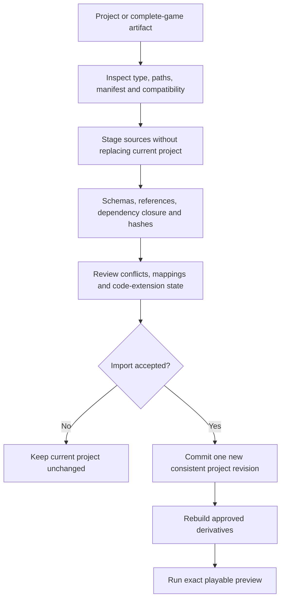

# Project format, artifacts and import/export contracts

[Studio index](README.md) · [Build/export](RUNTIME_BUILD_EXPORT.md) · [Automation](AUTOMATION_AND_EXTENSION_API.md) · [Acceptance](ACCEPTANCE_AND_ROUNDTRIP.md)

**Proposed formats, not current import support.** The existing JSON backup remains player progress. The studio needs a separate canonical project that preserves everything required to edit and reproduce a game.

The [conformance blueprint](blueprints/IMPORT_EXPORT_CONFORMANCE.md) expands staging, member/path, source-preservation and failure rules. [Example bundle metadata](specs/examples/bundle.json) describes a not-built package; no actual archive or file hashes are claimed.

## Artifact profiles

Names/extensions below are proposed product conventions.

| Profile | Artifact | Playable | Lossless whole-project editing | Purpose |
| --- | --- | --- | --- | --- |
| Editable project | .echo-project.zip | No | Yes, within supported project format | Open/edit or transfer the canonical project; no compiled player required. |
| Complete game bundle (default) | .echo-bundle.zip | Yes | Yes, within supported project format | Play and reimport into the studio with complete authoring sources. |
| Play-only web build | .echo-game.zip | Yes | No whole-project guarantee | Smaller distribution; source layers/graphs cannot be guaranteed recoverable. |
| Reusable asset pack | .echo-assets.zip | No | No whole-project guarantee | Import selected reusable assets with conflict mapping; not a complete game/project. |
| Player progress backup | .echo-save.json | No | No whole-project guarantee | Restore player progress for a compatible game; not authoring content. |
| Source/developer export | .echo-source.zip | No | Yes, within supported project format | Rebuild and extend the game's implementation outside the studio. |

The default complete-game profile includes both outputs. A runtime-only game can be imported for supported inspection/conversion, but missing layers, music notes, SFX nodes or custom source cannot be reconstructed reliably from flattened runtime files.

## Canonical editable project

```text
project/
  project.json
  content/
    maps/ encounters/ objectives/ actors/ ai/
    jobs/ abilities/ statuses/ progression/
    items/ shops/ recipes/ campaign/ quests/ dialogue/
    ui/ controls/ localization/
  assets/
    pixel-documents/ source-images/ geometry/ materials/ fonts/
    audio-sources/ instruments/ music/ sound-effects/ ambience/ voice/
  presentation/
    animations/ effects/ particles/ mixers/ cues/
  extensions/
    source/ manifests/ tests/
  engine/
    compatibility.json
    source-lock.json
    source-overrides/
  provenance/
    sources.json
    notices/
  editor/
    optional-layout.json
    recovery-checkpoints/
```

The folder structure is conceptual; stable IDs, not filesystem display names, own references. User folders and source filenames may be reorganized through validated reference-aware operations.

## Proposed manifest example

```json
{
  "format": "echoes-studio-project-proposal",
  "projectSchemaVersion": 1,
  "projectId": "example-authoring-project",
  "revision": 42,
  "engineCompatibility": {
    "api": "proposed-api-1",
    "sourceLock": "engine/source-lock.json"
  },
  "entryCampaign": "campaign-main",
  "entryUI": "ui-main-menu",
  "defaultLocale": "en",
  "sourceAssetManifest": "provenance/sources.json"
}
```

This illustrative JSON is planning metadata, not a supported game/project file. The actual schema and compatibility range require SD-01/SD-02/SD-08 decisions and migration fixtures.

## Required source preservation

| Domain | Canonical editable source | Rebuildable derivative |
| --- | --- | --- |
| Maps | Tiles/heights, props, collisions, zones, triggers and environment references | Mesh batches, navigation caches and previews |
| Rules/content | Typed definitions, graphs, formulas and scripts | Validated runtime catalogs |
| Pixel art | Layers/cels, palette/index mode, dimensions and source pixels | PNG/WebP atlases, thumbnails |
| Animation | Frame IDs, durations, direction tags, pivots, attachments and state graph | Packed frames and runtime clip tables |
| 3D/environment | Source geometry, material definitions and prefab/collision data | Target-optimized geometry/textures |
| Effects | Emitter/curve/layer graph, source clips and anchors | Compiled bounded emitter data |
| Music | Notes/patterns, instruments, arrangement, tempo and automation | Mixed tracks/stems/compiled score |
| SFX | Synth/sample graphs, envelopes, source recordings and edit lists | Runtime clips or compiled audio graphs |
| Voice/ambience | Original takes, loop/region edits, localization/subtitle/emitter binding | Encoded clips and cue tables |
| UI/controls | Layout/theme/font/icon/string bindings and input profiles | Runtime layout/styles and defaults |
| Custom behavior | Extension source, tests, API manifest and engine overrides | Compiled browser modules |
| Provenance | Sources, prompts where applicable, author/rights notes and processing versions | Required runtime notices/report |

Do not put a packed atlas, compressed audio bounce or compiled script in the source role when a richer studio document exists.

## Identity and revision rules

| Identity | Purpose | Separate from |
| --- | --- | --- |
| Project ID | Distinguish game projects/forks | A player's save slot |
| Content/asset ID | Stable references through rename/move | Human-readable display names |
| Revision ID | Optimistic concurrency and authoring history | Simulation activation counter |
| Engine/API version | Runtime/extension compatibility | Project schema version |
| Build ID/hash | Identify compiled output and provenance | Editable workspace's current dirty state |
| Save format/content identity | Restore compatible player progress | Editable project archive version |
| Source/render hash | Detect changed master or derivative | Visual/audio quality approval |

Full import preserves the original project/content identities unless the user deliberately forks/remaps. Forking offers an explicit new project identity and a declared player-save compatibility policy.

## Import transaction



| Case | Required behavior |
| --- | --- |
| Duplicate content IDs | Explicit merge/remap/replace plan; no silent overwrite |
| Missing dependency | Name referencing asset/content and offer a supported resolution |
| Newer/unsupported schema | Preserve archive; diagnose compatibility and supported migration |
| Changed engine/source lock | Show required engine/extension compatibility before activating code |
| Partial/corrupt archive | Reject/rollback staging; preserve current workspace/recovery |
| Invalid archive path or manifest reference | Reject outside-root/ambiguous paths and malformed references |
| Existing player save | Keep separate; test compatibility before offering restore into a different build |
| Optional unknown editor metadata | Preserve where possible without changing runtime authority |

Package-defined custom code is reviewed/activated through an explicit extension workflow. Content parsing is not an authorization to execute imported build scripts.

## Complete-game bundle

```text
complete-game/
  play/
    index.html
    assets/
    game-manifest.json
  edit/
    project.echo-project.zip
  source/
    engine/
    build-scripts/
    dependency-lock/
  reports/
    build-report.json
    dependency-and-provenance.json
  HOW_TO_PLAY_AND_EDIT.md
```

The project payload preserves custom code/graphs and rich source assets. The matching engine source/build lock makes fundamental game behavior editable and reproducible. The toolkit editor itself has its own version; import verifies its supported project/extension API.

The player build must not fetch authoring payloads or require the editor to run. Editing sources remain available as a separate payload in the bundle. Distributing a public complete bundle also distributes those sources; the export UI must make the selected contents explicit.

## Lossless round-trip contract

1. Export a committed revision using project or complete-game mode.
2. Import into a clean compatible studio without relying on the originating workspace.
3. Compare normalized source graphs/IDs, source pixel/sample hashes, timings, notes, layers, code and provenance.
4. Rebuild using the included engine/toolchain lock.
5. Verify gameplay behavior and asset/audio outputs under the declared parity rules.
6. Edit a layer, note, SFX node, map/objective and custom rule again, then repeat export/import.

ZIP timestamps and encoded metadata can differ without source loss; normalized semantic/source identity is the primary comparison. Exact derivative-byte reproducibility needs pinned encoder/toolchain versions and declared normalization.

## Player-save boundary

Player progress export remains a different artifact. It stores resources, quest/encounter state and compatibility identity, not editor layers or sound graphs. Editing a game can invalidate old player progress; preview/play saves must never silently overwrite a published game's saves. A project import does not automatically migrate or discard those saves.

