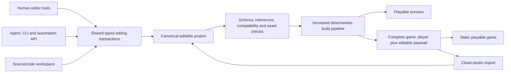

# Complete game authoring studio plan

[Documentation index](../README.md) · [Expansion roadmap](../ROADMAP.md) · [Studio milestones](STUDIO_ROADMAP.md) · [Acceptance gates](ACCEPTANCE_AND_ROUNDTRIP.md)

**Planned authoring toolkit; not implemented editor features.** The goal is to create, edit, test, import and export a complete playable tactical RPG using one coherent toolset. The current game remains v0.8 with source-defined content, a character/effect review workbench and synthesized audio sketch.

The default **Complete game** export must contain a playable build **and** the editable project/source payload. Pixel layers, animation timelines, music notes/arrangements, sound-effect graphs, cue bindings, rules and custom code must survive export/import. A separate smaller Play-only export discloses its reduced editing guarantees.

## Studio library

| Guide | Scope |
| --- | --- |
| [Authoring workflows](AUTHORING_WORKFLOWS.md) | Every game-editing domain, editor tools and complete user paths |
| [Audio studio](AUDIO_STUDIO.md) | Music composition, original SFX design, sampling/recording, ambience, voice, mixing and cues |
| [Project format](PROJECT_FORMAT.md) | Canonical sources, stable IDs, versions, artifacts and lossless round trips |
| [Runtime/build/export](RUNTIME_BUILD_EXPORT.md) | Shared player runtime, compilation, preview, complete-game packaging and deployment |
| [Automation/extensions](AUTOMATION_AND_EXTENSION_API.md) | UI/API/CLI parity, agent operations, custom rules and source editing |
| [Studio roadmap](STUDIO_ROADMAP.md) | Ten gates and eighty planned work items mapped to existing foundations |
| [Acceptance/round trips](ACCEPTANCE_AND_ROUNDTRIP.md) | Thirty-two acceptance scenarios and a full-game golden-project test |
| [Planning manifest](specs/studio-plan.json) | Machine-readable requirements, work items, stages, artifacts and acceptance references |

## Detailed editor blueprints

The [blueprint library](blueprints/README.md) expands the tool plan into six specifications: [editor shell](blueprints/EDITOR_SHELL_AND_INTERACTION.md), [pixel/animation](blueprints/PIXEL_ANIMATION_EDITOR.md), [level/rules](blueprints/LEVEL_AND_RULES_EDITORS.md), [audio nodes/cues](blueprints/AUDIO_NODE_AND_CUE_SPEC.md), [import/export conformance](blueprints/IMPORT_EXPORT_CONFORMANCE.md) and [implementation slices](blueprints/IMPLEMENTATION_SLICES.md).

Six small [JSON design examples](specs/blueprints.json) cover project identity, layered pixels/timeline, music/SFX graphs, level/objective, cross-domain edit batch and complete-game membership. They are proposal-only schema probes: checks do not render audio/art, apply editor changes or build a playable bundle. npm run docs:studio:examples validates their internal references and constraints.

Five [advanced authoring specifications](specs/advanced-blueprints.json) extend the core six blueprints with typed rules/AI, campaign/economy/UI, VFX/material/environment, project versioning/merges and an evidence-based toolkit release plan. Four additional examples exercise contract calculations and references through npm run docs:studio:advanced; they do not implement editors, run migrations or render assets.

## Full authoring coverage

Every requirement needs a real editing path, an inspectable data model, validation, undo/redo where applicable, runtime compilation and export/import coverage.

| ID | Domain | Required coverage |
| --- | --- | --- |
| STREQ-01 | Workspace | Create, clone, rename, version, recover and organize complete projects. |
| STREQ-02 | Level design | Edit dimensions, height, terrain, collision, props, lighting, camera and navigation. |
| STREQ-03 | Missions | Edit deployment, objectives, waves, boss phases, triggers and rewards. |
| STREQ-04 | Rules | Edit combat formulas, targeting, statuses, reactions, timing and difficulty. |
| STREQ-05 | Progression | Edit jobs, ability boards, lessons, unlocks, supports and growth. |
| STREQ-06 | Actors and AI | Edit companions, enemies, summons, stats, loadouts and behavior profiles. |
| STREQ-07 | Economy | Edit gear, consumables, shops, recipes, loot and transaction rules. |
| STREQ-08 | Campaign | Edit routes, quests, factions, recruitment, choices and endings. |
| STREQ-09 | Narrative/localization | Edit dialogue, codex, speaker portraits, subtitles and localized strings. |
| STREQ-10 | Pixel art | Create layered pixel art, palettes, tiles, portraits, icons and source sheets. |
| STREQ-11 | Animation | Edit frames, durations, directions, pivots, events and state transitions. |
| STREQ-12 | Environment assets | Import/edit modular props, materials, collision and environment prefabs. |
| STREQ-13 | VFX | Edit effect clips, emitters, trails, curves, blending, anchors and resource budgets. |
| STREQ-14 | Music | Compose/import/edit notes, patterns, arrangements, stems, tempo, loops and adaptive transitions. |
| STREQ-15 | Sound effects | Synthesize, record/import, layer, trim and automate original gameplay/UI sound effects. |
| STREQ-16 | Ambience and voice | Edit ambient beds, emitters, dialogue recordings, subtitles and localized audio. |
| STREQ-17 | Audio integration | Edit buses, effects, loudness, spatialization, variations and resolved-event cue bindings. |
| STREQ-18 | Presentation and controls | Edit UI layouts/themes/fonts, menus, input maps and accessibility defaults. |
| STREQ-19 | Code extensions | Edit custom rules/runtime source and versioned extension modules with reproducible builds. |
| STREQ-20 | Automation | Expose the same editing transactions to UI, CLI and agent/API clients. |
| STREQ-21 | Preview and diagnostics | Playtest exact builds with seeds, breakpoints, inspector, performance and validation reports. |
| STREQ-22 | Project round trip | Import/export editable projects preserving source layers, graphs, code and stable IDs. |
| STREQ-23 | Complete game distribution | Export a playable game plus editable payload and reimport it into a clean studio. |
| STREQ-24 | Compatibility and delivery | Manage engine/project/save versions, dependencies, offline behavior and deployment targets. |

## The central architecture

The same engine build runs preview and exported gameplay. The editor is not a separate simulation. Authoring undo history, selections and tool settings stay separate from player saves and combat state.

## Meaning of fully editable

| Layer | Editing route | Preservation requirement |
| --- | --- | --- |
| Standard game content | Forms, inspectors, maps, graphs and timelines | Typed source records and stable references |
| Pixels and visuals | Layered pixel/tile/sprite tools and environment inspectors | Original layers/palettes/frames/geometry plus build derivatives |
| Music and SFX | Piano roll/arranger, synth/sample graphs, waveform editor and mixer | Notes, graphs, source recordings, automation and cue bindings |
| Game behavior | Rule graphs/data for supported mechanics; code extension/source workspace for new ones | Source, API versions, build configuration and dependency lock |
| Presentation | UI/theme, animation/VFX and audio editors | Layouts, bindings, accessibility defaults and alternatives |
| Distribution | Project, complete-game, runtime-only, asset-pack, save and source profiles | Explicit artifact capabilities; complete bundle reopens losslessly |

Full coverage includes a source-level route for new engine behavior. A finite form editor cannot anticipate every future mechanic. Runtime extensions and engine-source export keep the game extensible while ordinary editing remains data-driven.

Round-trip guarantees apply to the toolkit's documented formats. Third-party art, audio, models and content need explicit import adapters and mapping; importing an unrelated game's executable is a different problem.

## Proposed open decisions

| ID | Topic | Recommendation to investigate |
| --- | --- | --- |
| SD-01 | Canonical project format | Versioned project package with stable IDs, source assets and engine/source lock. |
| SD-02 | Runtime/authoring boundary | Compile project content into the shared deterministic runtime; keep editor state separate. |
| SD-03 | Default game export | Default to playable plus editable project/source payload; label runtime-only mode explicitly. |
| SD-04 | Audio codecs and encoding | Preserve source PCM/graphs and define supported import/decode/export adapters per target. |
| SD-05 | Custom code and capabilities | Version extension APIs and include buildable source; imported code activation is explicit. |
| SD-06 | Pixel/animation sources | Preserve layers, palettes, frames, pivots and timing instead of treating packed atlases as masters. |
| SD-07 | Audio graph parity | Use one serializable graph/cue contract for realtime preview, offline render and game runtime. |
| SD-08 | Versions, saves and offline | Separate project/engine/build/save identities and validate update/migration before activation. |

These remain open. [ADR-0011](../adr/0011-proposed-editable-game-project-and-build-artifacts.md) and [ADR-0012](../adr/0012-proposed-shared-music-and-sfx-graphs.md) capture concrete proposed directions without accepting a schema or claiming an editor exists.

## First proof before a large tool rollout

Import the current game into the proposed project format, change one map tile, one ability value, one layered sprite frame, one music phrase and one synthesized sound effect through shared editing commands. Bind the sound to a resolved action, preview it, export the default complete bundle, import it in a clean workspace and edit each source again.

Do not count a runtime-only ZIP, a menu mockup or flattened sprite/audio output as proof of a full authoring round trip. Complete gates are in the [acceptance guide](ACCEPTANCE_AND_ROUNDTRIP.md).

