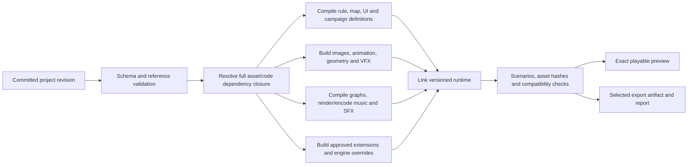
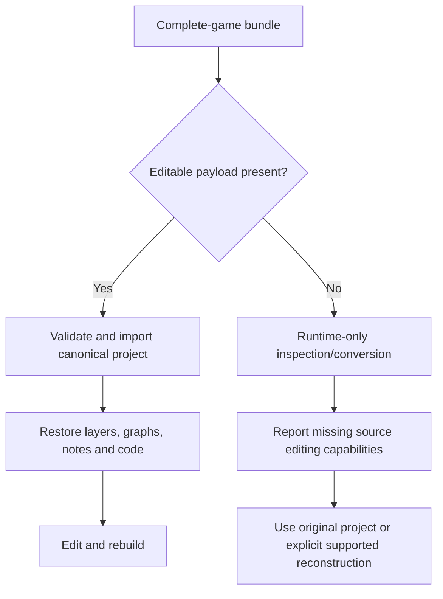

# Shared runtime, playtest, build and playable export

[Studio index](README.md) · [Project format](PROJECT_FORMAT.md) · [Audio](AUDIO_STUDIO.md) · [Acceptance](ACCEPTANCE_AND_ROUNDTRIP.md)

**Planned pipeline.** Current Vite/Pages builds work from repository source. Studio projects require a validated content/extension build seam so preview and export consume the same game.

## Runtime integration strategy

| Current implementation | Proposed authoring adapter | Acceptance |
| --- | --- | --- |
| In-source job/skill/item/support records | Validated compiled project catalogs | Current template produces equivalent rule results |
| Fixed map/roster creation | Versioned map/deployment definitions | Old fixtures preserved; approved alternate dimensions/rosters work |
| Current objective/AI code | Approved objective/behavior definitions and extension hooks | Preview/resolution/AI use the same legality |
| Current atlas manifests | Compiler outputs from rich source documents | Registration, source identity and fallback remain valid |
| AudioScore sketch | Shared music/SFX graph, mixer and cue runtime | Preview/offline/export parity and load deduplication |
| React HUD and camp | Versioned UI/theme/control schemas plus source extensions | Full supported player path remains navigable |
| Expedition v2 storage | Build/content identity plus supported-save contracts | Current saves never silently attach to incompatible edited content |

A loader/compiler seam must not weaken validation merely to accept arbitrary project data. Reproduce the current game as the first template before widening authored mechanics.

## Build pipeline

Required missing assets/code/cues fail preflight with source locations. Optional fallback behavior is explicit, not a way to call an incomplete game build successful.

## Preview modes

| Mode | Purpose | Isolation |
| --- | --- | --- |
| Asset audition | Pixel animation, effect, instrument or sound clip | No campaign mutation |
| Mission test | Specific seed, roster, objective and diagnostic settings | Temporary save namespace and explicit reset |
| Full game test | Title/menu → new game → campaign → battle → settlement | Uses the same compiled runtime as export |
| Compatibility test | Restore approved save fixture against target build | Read-only fixture copy until accepted |
| Performance/accessibility review | Quality/motion/audio/input profiles | Record build ID, device, settings and scene |
| Agent regression run | Scripted legal edits and scenarios | Typed commands/results; no hidden UI state assumptions |

The preview label should show project revision, build ID, engine/API version, seed and whether uncommitted edits are excluded. No separate editor-only damage formula, audio graph or collision system is allowed.

## Export profiles and UI

| Choice | Default? | Outcome |
| --- | --- | --- |
| Complete game | Yes | Playable web build, editable project payload, matching engine source/build locks and report |
| Editable project | Explicit | Lossless authoring archive, suitable for backup/collaboration |
| Play-only web build | Explicit | Smaller playable package; excludes rich authoring payload |
| Asset pack | Explicit | Selected assets/graphs with dependency closure and remap metadata |
| Source/developer export | Explicit | Project plus buildable engine/extensions and reproducible build configuration |
| Player progress | Separate player feature | Compatible save backup, not a project |

Export review lists included sources, project/build identity, required notices, supported launch method and any excluded editor masters. User-selected public distribution is distinct from generating a local export file.

## Playability contract

The baseline export is a static browser game with bundled runtime code/content/art/audio. It runs without the authoring application, an application backend, generation service or the original repository. Optional remote services/fonts must have declared behavior; required gameplay cannot accidentally depend on an editor/dev URL.

| Launch target | Contract |
| --- | --- |
| Studio Play | Integrated preview host serves the exact build and validates its assets |
| Static host / GitHub Pages | Configurable base path, all runtime dependencies included, fetch/hash smoke check |
| Local play | Included launcher instructions or a validated local preview server workflow |
| Offline/PWA | Separate approved cache/update/save-compatibility profile |
| Self-contained HTML | Optional future exporter with explicit size/resource constraints and parity tests |

Do not assume a module/fetch-based web build runs correctly by double-clicking index.html on a file URL. Include an actual tested launch path. Node/build tooling may be needed for developer rebuilds, not for a deployed player's browser session.

## Reimport a playable distribution

Complete-game reimport is an acceptance requirement. Runtime-only import can recover supported flattened assets/catalogs, but cannot promise missing layer stacks, source recordings, notes or original custom code.

## Build report

| Field | Required content |
| --- | --- |
| Identity | Project/revision, build ID, engine/API and schema versions |
| Inputs | Source/dependency hashes, encoder/compiler versions and build profile |
| Outputs | Runtime files, bytes, hashes and artifact membership |
| Features | Enabled code/extensions, audio codec targets and quality profiles |
| Validation | Structural/scenario/asset results with unsupported checks explicitly listed |
| Compatibility | Player-save identity/range, required migration and known limitations |
| Provenance | Source/rights inventory and included notices |
| Launch | Base path, local/static instructions and offline policy |
| Reimport | Editable payload presence and round-trip verification status |

## Release and failure behavior

An invalid edited project keeps the last valid preview/build available for comparison. It does not silently export the old build as if it contained the requested edits. Report which revision succeeded and which failed.

A game built by the tools must include a real title/new-game path, required menus/controls, authored mission/campaign progression, win/fail/retry behavior, music/SFX/visual cues, settings/recovery and a clear supported end state. An asset viewer alone is not the playable-game gate.

