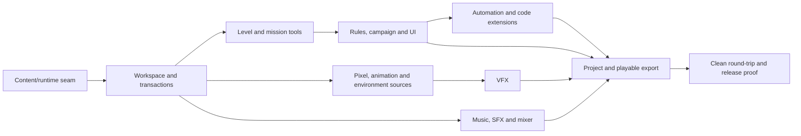

# Studio milestones and tooling backlog

[Studio index](README.md) · [Original game backlog](../roadmap/BACKLOG.md) · [Acceptance](ACCEPTANCE_AND_ROUNDTRIP.md)

**All eighty studio items are planned.** They extend, rather than replace, the original 160 game-expansion items. STU IDs identify authoring-tool work; STREQ IDs identify full-editability requirements.

## Gates

| Gate | Name | Depends on | Acceptance |
| --- | --- | --- | --- |
| STAGE-0 | Runtime content seam | Baseline | Compile validated project content into the current runtime; preserve existing IDs, rules and save fixtures. |
| STAGE-1 | Workspace and transactions | STAGE-0 | Create/recover a project; stable IDs, undo/redo, revision checks and asset ownership work. |
| STAGE-2 | Level and mission authoring | STAGE-1 | Build and play one alternate map/objective using real editor controls and the shared runtime. |
| STAGE-3 | Game systems and campaign | STAGE-1, STAGE-2 | Author a complete route, actors, jobs, abilities, economy, dialogue, UI and localization. |
| STAGE-4 | Visual source authoring | STAGE-1 | Edit layered pixels, frames/directions, pivots and prop assets; compiled output matches preview. |
| STAGE-5 | Effects and presentation | STAGE-0, STAGE-4 | Author bounded effect/particle graphs and bind them to resolved events with reduced-motion alternatives. |
| STAGE-6 | Music and sound studio | STAGE-0, STAGE-1 | Compose music, synthesize/layer SFX, edit ambience/voice and mix/bind cues in a playable preview. |
| STAGE-7 | Automation and code extensions | STAGE-1, STAGE-3 | UI/API/CLI share typed transactions; custom rules/source changes build, diagnose and round-trip. |
| STAGE-8 | Project and playable export | STAGE-3, STAGE-4, STAGE-5, STAGE-6, STAGE-7 | Export complete-game bundle; import in a clean studio; play the result with source editing intact. |
| STAGE-9 | Authoring release gate | STAGE-8 | Pass full golden-project round trips, supported-device/editor access checks, migration and offline/update rehearsals. |

These are acceptance dependencies, not a calendar. Audio and art pilots can begin once the shared project/preview seam exists; they should not wait until the entire content editor is finished.

Six bounded [prototype slices](blueprints/IMPLEMENTATION_SLICES.md) refine how to start the shared project, map, pixel, music/SFX, API and export work. They reuse existing work IDs and do not mark any item complete.

## First cross-domain pilot

Before a broad rollout, import the current game into a canonical project; edit one map tile, ability, sprite frame, musical phrase and original SFX; bind cues; preview; export Complete game; import cleanly; edit each source again. This pilot establishes the shared contracts. It does not certify every tool or the final content scope.

## Work tracks

Each row includes exact dependencies and evidence. Existing FND/MAP/CBT/etc IDs refer to the original game roadmap and remain planned prerequisites.

### CORE — Workspace and shared project model

Primary gate: STAGE-1.

| ID | Work | Dependencies | Requirement coverage | Acceptance evidence |
| --- | --- | --- | --- | --- |
| STU-CORE-01 | Current-game content adapter | FND-02, FND-04 | STREQ-04, STREQ-21 | Compile the current catalogs into a project without changing baseline fixtures. |
| STU-CORE-02 | Canonical schema and identities | STU-CORE-01, SAV-01 | STREQ-01, STREQ-24 | Version project/content/build identities and reject unresolved references. |
| STU-CORE-03 | Project browser and revisions | STU-CORE-02 | STREQ-01 | Create, clone, open and checkpoint a project with stable revision identity. |
| STU-CORE-04 | Typed transactions and undo | STU-CORE-03 | STREQ-01, STREQ-20 | UI/API batches commit atomically; undo restores source documents/assets. |
| STU-CORE-05 | Asset/dependency browser | STU-CORE-04 | STREQ-01, STREQ-22 | Trace usages, hashes and dependency closure before rename/delete/export. |
| STU-CORE-06 | Schema-driven inspectors | STU-CORE-04 | STREQ-04, STREQ-18, STREQ-20 | Inspect/edit fields, units, constraints and references through common commands. |
| STU-CORE-07 | Project recovery and conflicts | STU-CORE-04, SAV-05 | STREQ-01, STREQ-24 | Recover a consistent revision and reject stale conflicting writes. |
| STU-CORE-08 | Editor navigation and diagnostics | STU-CORE-06, UX-02 | STREQ-18, STREQ-21 | Keyboard-accessible tools report field/node/source errors and preserve last valid build. |

### MAP — Level and encounter editors

Primary gate: STAGE-2.

| ID | Work | Dependencies | Requirement coverage | Acceptance evidence |
| --- | --- | --- | --- | --- |
| STU-MAP-01 | Map source document | STU-CORE-02, MAP-01 | STREQ-02 | Persist dimensions, tiles, heights, collision, zones and environment references. |
| STU-MAP-02 | Terrain brushes and region edits | STU-MAP-01, STU-CORE-04 | STREQ-02 | Paint, fill, resize and copy regions with undo and affected-reference review. |
| STU-MAP-03 | Props and environment placement | STU-MAP-02, STU-ART-07 | STREQ-02, STREQ-12 | Edit transform, collision, light/camera and interactable state consistently. |
| STU-MAP-04 | Deployment and roster authoring | STU-MAP-01, MAP-04 | STREQ-03, STREQ-06 | Place legal ally/enemy/neutral zones and explicit simulation order. |
| STU-MAP-05 | Objective/failure graph editor | STU-MAP-04, OBJ-01 | STREQ-03 | Define counters and precedence; test win/fail/retry/resume. |
| STU-MAP-06 | Waves and boss phases | STU-MAP-05, AI-07 | STREQ-03 | Edit saved triggers/spawns/phase actions without duplicate waves on reload. |
| STU-MAP-07 | Map/mission validation view | STU-MAP-03, STU-MAP-06 | STREQ-02, STREQ-03, STREQ-21 | Locate invalid cells, collisions, references and required-route issues. |
| STU-MAP-08 | Exact mission playtest | STU-MAP-07, STU-CORE-01 | STREQ-03, STREQ-21 | Run a chosen revision/seed through the same runtime as export. |

### CONTENT — Rules, actors, campaign and UI

Primary gate: STAGE-3.

| ID | Work | Dependencies | Requirement coverage | Acceptance evidence |
| --- | --- | --- | --- | --- |
| STU-CONTENT-01 | Actor and AI profile editors | STU-CORE-06, AI-03 | STREQ-06 | Edit roster identity/stats/roles and inspect legal AI choices. |
| STU-CONTENT-02 | Rules/jobs/ability boards | STU-CORE-06, FND-05, CBT-07 | STREQ-04, STREQ-05 | Edit formulas, targeting, statuses, reactions, learning and unlock graphs with shared previews. |
| STU-CONTENT-03 | Items, shops and recipes | STU-CONTENT-02, ECO-02 | STREQ-07 | Edit gear/consumables/crafting/loot with transaction and ownership checks. |
| STU-CONTENT-04 | Campaign, dialogue and quests | STU-CONTENT-01, NAR-02, NAR-03 | STREQ-08, STREQ-09 | Author routes, choices, factions, recruits, codex and endings with saved consequences. |
| STU-CONTENT-05 | UI/theme/control schemas | STU-CORE-06, UX-02 | STREQ-18 | Edit menus/HUD/fonts/layout/input/accessibility defaults and play the full control path. |
| STU-CONTENT-06 | Localization and voice references | STU-CONTENT-04, STU-SFX-08 | STREQ-09, STREQ-16 | Map strings, subtitles, speakers and locale takes with missing/overflow diagnostics. |
| STU-CONTENT-07 | Content graph validation | STU-CONTENT-03, STU-CONTENT-04, STU-CONTENT-05 | STREQ-04, STREQ-08, STREQ-21 | Reject cycles, missing content and unreachable required routes before export. |
| STU-CONTENT-08 | Full-game preview flow | STU-CONTENT-07, STU-MAP-08 | STREQ-18, STREQ-21 | Run title/new-game, campaign, battle, failure/retry, victory and supported ending. |

### ART — Pixel art, tiles and environment sources

Primary gate: STAGE-4.

| ID | Work | Dependencies | Requirement coverage | Acceptance evidence |
| --- | --- | --- | --- | --- |
| STU-ART-01 | Layered pixel source format | STU-CORE-05 | STREQ-10 | Preserve dimensions, color mode, layers/cels, source pixels and palettes. |
| STU-ART-02 | Pixel tools and selections | STU-ART-01, STU-CORE-04 | STREQ-10 | Brush/erase/fill/select/transform/clipboard edits round-trip and undo. |
| STU-ART-03 | Layers and palette workflow | STU-ART-02 | STREQ-10 | Reorder/group/opacity and indexed/RGBA edits preserve source and transparent semantics. |
| STU-ART-04 | Tileset authoring | STU-ART-03, STU-MAP-01 | STREQ-02, STREQ-10 | Edit reusable tiles and terrain tags; paint them into maps. |
| STU-ART-05 | Visual import adapters | STU-ART-01, STU-CORE-05 | STREQ-10, STREQ-12 | Import supported raster/layer/model formats with explicit conversion/mapping reports. |
| STU-ART-06 | Portrait/icon/UI asset tools | STU-ART-03, STU-CONTENT-05 | STREQ-09, STREQ-10, STREQ-18 | Create and bind readable portraits/icons with source and locale/UI references. |
| STU-ART-07 | Geometry/material/prefab inspector | STU-ART-05 | STREQ-12 | Edit modular source geometry/material/collision and reusable environment prefabs. |
| STU-ART-08 | Visual source compiler | STU-ART-04, STU-ART-06, STU-ART-07 | STREQ-10, STREQ-12, STREQ-22 | Build runtime images/geometry without replacing rich masters; verify source/derivative hashes. |

### ANIM — Animation source and runtime binding

Primary gate: STAGE-4.

| ID | Work | Dependencies | Requirement coverage | Acceptance evidence |
| --- | --- | --- | --- | --- |
| STU-ANIM-01 | Timeline/clip schema | STU-ART-01, STU-CORE-02 | STREQ-11 | Persist frame/cel IDs, duration, tags, direction and registration. |
| STU-ANIM-02 | Frame/cel editing | STU-ANIM-01, STU-ART-02 | STREQ-11 | Add, duplicate, reorder and edit frames with exact duration and undo. |
| STU-ANIM-03 | Onion skin and loop audition | STU-ANIM-02 | STREQ-11 | Compare adjacent cels and inspect loop/contact timing at game scale. |
| STU-ANIM-04 | Pivots, directions and attachments | STU-ANIM-02, ART-01 | STREQ-11 | Edit foot/pivot/weapon markers and direction mapping across camera quadrants. |
| STU-ANIM-05 | State/event binding editor | STU-ANIM-04, FND-05 | STREQ-11, STREQ-13 | Bind idle/walk/attack/cast/hurt/guard/down/revive without changing rule timing. |
| STU-ANIM-06 | Packing and registration compiler | STU-ANIM-04, STU-ART-08 | STREQ-11, STREQ-22 | Build atlases with padding, timing/anchor metadata and verified clip coverage. |
| STU-ANIM-07 | Runtime motion review | STU-ANIM-05, STU-ANIM-06 | STREQ-11, STREQ-21 | Preview transitions, interruption, load-held poses, enemy view and reduced motion. |
| STU-ANIM-08 | Timeline source round trip | STU-ANIM-07, STU-CORE-07 | STREQ-11, STREQ-22 | Reopen source frames, tags, directions, pivots and timings after serialization. |

### VFX — Effect and particle authoring

Primary gate: STAGE-5.

| ID | Work | Dependencies | Requirement coverage | Acceptance evidence |
| --- | --- | --- | --- | --- |
| STU-VFX-01 | Effect graph source schema | STU-CORE-06 | STREQ-13 | Persist layers, nodes, parameter units, anchors and supported blend modes. |
| STU-VFX-02 | Emitter and shape tools | STU-VFX-01 | STREQ-13 | Edit spawn rate/bursts, shapes, color, lifetime and sprite sources. |
| STU-VFX-03 | Curves and modulation | STU-VFX-02, STU-ANIM-04 | STREQ-13 | Edit motion/scale/opacity/color curves and attachment behavior. |
| STU-VFX-04 | Trails/projectile anchoring | STU-VFX-03, STU-ANIM-05 | STREQ-13 | Source/travel/contact phases stay attached through movement/camera changes. |
| STU-VFX-05 | Budget/quality profiles | STU-VFX-04, FND-09 | STREQ-13, STREQ-24 | Bound pools and render cost; record measured profile tradeoffs. |
| STU-VFX-06 | Resolved-event effect bindings | STU-VFX-04, FND-05 | STREQ-13 | Hit/miss/heal/buff/prop cues consume deduplicable resolved facts. |
| STU-VFX-07 | Low-motion/intensity alternatives | STU-VFX-05, UX-03 | STREQ-13, STREQ-18 | Edit static/low-intensity alternatives without gameplay timing changes. |
| STU-VFX-08 | Compile and preview effect graphs | STU-VFX-06, STU-VFX-07, STU-ANIM-06 | STREQ-13, STREQ-21, STREQ-22 | Export/reopen graphs and validate compiled clips, fallback and teardown. |

### MUSIC — Music composition and arrangement

Primary gate: STAGE-6.

| ID | Work | Dependencies | Requirement coverage | Acceptance evidence |
| --- | --- | --- | --- | --- |
| STU-MUSIC-01 | Audio source/graph/time contract | STU-CORE-02 | STREQ-14, STREQ-15, STREQ-17 | Define project sample/tick clocks, versioned nodes and source/master ownership. |
| STU-MUSIC-02 | Instrument rack | STU-MUSIC-01 | STREQ-14 | Create oscillator/sample instruments with envelopes, filters and modulation. |
| STU-MUSIC-03 | Piano roll and note commands | STU-MUSIC-02 | STREQ-14, STREQ-20 | Edit pitch/start/duration/velocity and audition through UI/API. |
| STU-MUSIC-04 | Patterns and arrangement | STU-MUSIC-03 | STREQ-14 | Reuse patterns, arrange/split/loop clips and preserve editable note sources. |
| STU-MUSIC-05 | Tempo/meter and automation | STU-MUSIC-04 | STREQ-14 | Edit musical-time maps and parameter curves with explicit render scheduling. |
| STU-MUSIC-06 | Stems and loop regions | STU-MUSIC-05 | STREQ-14, STREQ-17 | Route aligned stems and audition repeat/crossfade/tail boundaries. |
| STU-MUSIC-07 | Adaptive music transitions | STU-MUSIC-06, FND-05 | STREQ-14, STREQ-17 | Bind region/battle/phase state at declared musical boundaries without replayed stings. |
| STU-MUSIC-08 | Offline render and parity | STU-MUSIC-06, STU-SFX-06 | STREQ-14, STREQ-17, STREQ-22 | Bounce master/stems under shared graph semantics; compare source/PCM/loop parity. |

### SFX — Sound effects, sampling, ambience and mixing

Primary gate: STAGE-6.

| ID | Work | Dependencies | Requirement coverage | Acceptance evidence |
| --- | --- | --- | --- | --- |
| STU-SFX-01 | SFX synthesis graph | STU-MUSIC-01 | STREQ-15 | Create original oscillator/noise/sample effects with editable nodes. |
| STU-SFX-02 | Non-destructive waveform editor | STU-SFX-01, STU-CORE-05 | STREQ-15 | Trim/split/fade/reverse/normalize/loop original sources with retained edit lists. |
| STU-SFX-03 | Layered sound design | STU-SFX-01, STU-MUSIC-02 | STREQ-15 | Layer transients/body/tails; edit envelopes, filters, pitch sweeps and modulation. |
| STU-SFX-04 | Recording and sample import | STU-SFX-02 | STREQ-15, STREQ-16 | User-start takes/import supported clips; retain original sample/rate/channel provenance. |
| STU-SFX-05 | Variants, spatialization and cue policy | STU-SFX-03, STU-SFX-04, FND-05 | STREQ-15, STREQ-17 | Edit event bindings, weights, caps, priority, cooldown and pan/distance behavior. |
| STU-SFX-06 | Mixer and shared DSP engine | STU-SFX-03, STU-MUSIC-02 | STREQ-17 | Route buses/sends/ducking and use shared realtime/offline/runtime graph semantics. |
| STU-SFX-07 | Codec/render adapters | STU-SFX-06, STU-SFX-04 | STREQ-15, STREQ-17, STREQ-22 | Encode supported runtime targets; preserve masters and diagnose unsupported codecs. |
| STU-SFX-08 | Ambience, voice and subtitles | STU-SFX-05, STU-SFX-06, STU-CONTENT-04 | STREQ-16, STREQ-17 | Edit beds/emitters/locale takes and subtitle links; mute/resume/loop behavior is correct. |

### API — Automation, diagnostics and source extensions

Primary gate: STAGE-7.

| ID | Work | Dependencies | Requirement coverage | Acceptance evidence |
| --- | --- | --- | --- | --- |
| STU-API-01 | Capability/schema discovery | STU-CORE-06 | STREQ-20 | Describe every editor operation, constraint, format and unsupported capability. |
| STU-API-02 | Typed domain commands | STU-CORE-04, STU-API-01 | STREQ-20 | UI/API/CLI share validated changes and stable document IDs. |
| STU-API-03 | Batch/conflict/diff workflow | STU-API-02, STU-CORE-07 | STREQ-20 | Stage, diff, validate, commit/abort with actionable source errors and recovery. |
| STU-API-04 | Pixel/music/SFX automation | STU-API-02, STU-ART-03, STU-MUSIC-04, STU-SFX-03 | STREQ-10, STREQ-14, STREQ-15, STREQ-20 | Agent commands edit actual layers, notes and sound nodes, not only flattened outputs. |
| STU-API-05 | Scenario/debug result API | STU-API-03, STU-CONTENT-08, STU-MAP-08 | STREQ-21 | Return real preview builds, seeds, rule results, visual/audio auditions and diagnostics. |
| STU-API-06 | Versioned code/inspector extensions | STU-API-01, STU-CONTENT-02 | STREQ-19 | Edit/export source modules and custom inspectors with explicit API compatibility. |
| STU-API-07 | Engine-source build workspace | STU-API-06, FND-09 | STREQ-19, STREQ-24 | Preserve engine overrides, build scripts and locks; clean rebuild needs no hidden vendor source. |
| STU-API-08 | UI/API/CLI parity proof | STU-API-04, STU-API-05, STU-API-07 | STREQ-20, STREQ-21 | Complete representative edits in every domain through both UI and automation. |

### PACK — Import, build, distribution and round trips

Primary gate: STAGE-8.

| ID | Work | Dependencies | Requirement coverage | Acceptance evidence |
| --- | --- | --- | --- | --- |
| STU-PACK-01 | Artifact and compatibility schemas | STU-CORE-02, SAV-01 | STREQ-22, STREQ-23, STREQ-24 | Separate project/complete-game/runtime/asset/save/source formats and identity/version rules. |
| STU-PACK-02 | Lossless source project export | STU-CORE-05, STU-ART-08, STU-ANIM-08, STU-MUSIC-06, STU-SFX-06, STU-API-07 | STREQ-22 | Include rich sources, code, provenance and dependency closure; reopen to edit again. |
| STU-PACK-03 | Staged project/complete-bundle import | STU-PACK-01, STU-PACK-02 | STREQ-22, STREQ-23 | Inspect, map conflicts, validate and commit without partially replacing a workspace. |
| STU-PACK-04 | Shared runtime compiler | STU-CONTENT-08, STU-VFX-08, STU-MUSIC-08, STU-SFX-07 | STREQ-21, STREQ-23 | Build exact preview/export runtime with all required code, content, visuals and audio. |
| STU-PACK-05 | Default Complete game bundle | STU-PACK-03, STU-PACK-04, STU-API-07 | STREQ-23 | Ship playable output plus editable payload and matching buildable engine source. |
| STU-PACK-06 | Launch/static-host profiles | STU-PACK-04, QA-06 | STREQ-23, STREQ-24 | Test local preview launch and root/subpath hosting without studio/backend dependencies. |
| STU-PACK-07 | Save/offline/update compatibility | STU-PACK-06, SAV-08 | STREQ-24 | Keep project/play saves separate and rehearse compatible update/cache/migration paths. |
| STU-PACK-08 | Golden game and clean re-edit proof | STU-PACK-05, STU-PACK-07, STU-API-08, STU-SFX-08 | STREQ-01, STREQ-22, STREQ-23, STREQ-24 | Author, play, export, import, re-edit and rebuild the complete fixture in a clean environment. |

## Completion rule

A tool is complete only when its data survives project and default complete-game round trips, its compiled result plays through the shared runtime, and equivalent UI/API operations exist. Music-only editing does not complete SFX; a flattened atlas does not complete layered pixel sources; a runtime-only ZIP does not complete lossless authoring export.

No studio milestone is marked implemented by this planning update. [Acceptance scenarios](ACCEPTANCE_AND_ROUNDTRIP.md) and the [planning manifest](specs/studio-plan.json) provide traceable gates.

