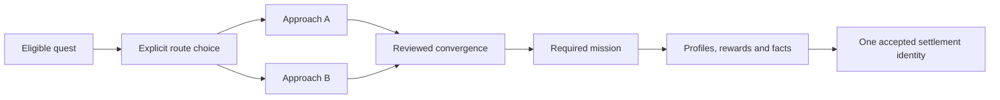

# Campaign, economy, dialogue and UI authoring

[Blueprint library](README.md) · [Campaign design](../../roadmap/CAMPAIGN_QUEST_BLUEPRINTS.md) · [Project sources](../PROJECT_FORMAT.md)

**Blueprint BP-CAMPAIGN, proposed.** Coverage: STREQ-07/08/09/18/20/22/24. These tools remain planned.

## Connected authoring surfaces

| Editor | Source data | Required preview |
| --- | --- | --- |
| Campaign map | Nodes, routes, conditions, mission references and unlock presentation | Required-path/branch review and actual traversal |
| Quest | Stable IDs, eligibility, progress, outcomes and saved facts | Before/after transitions and restore checkpoints |
| Faction/recruitment | Consequences, stable identities, initial assets and alternatives | No duplicate recruit or required-service softlock |
| Dialogue/codex | Speakers, choices, conditions, localized strings and media | Cancel/commit, spoiler visibility and focus |
| Economy | Item/stack definitions, shops, recipes, loot and ledgers | Source/sink and invalid-transaction cases |
| UI/theme | Layout/components, styles, fonts, data bindings and navigation | Full supported control path, not only a screenshot |
| Controls/settings | Action IDs, device mappings, preferences and defaults | Conflicts, reset, disconnect and restore |

The [campaign/UI example](../specs/advanced/campaign-ui.json) is a synthetic data fixture. It demonstrates references and branch/economy/UI constraints, not shipped story content.

## Quest and branch contract

| Property | Rule |
| --- | --- |
| Eligibility | Typed required-all/required-any facts and explicit choice conditions |
| Identity | Quest/mission/recruit/choice IDs remain stable through text edits |
| Progress | Belongs either to the active attempt or settled campaign; never ambiguous |
| Choice | Focus/cancel does not commit; confirmation records one permitted value |
| Convergence | Either approved branch can reach required content |
| Replay | One-shot consequences and rewards have deduplication identity |
| Failure/retry | State exactly which facts reset with an attempt |
| Localization | String/media keys do not alter branch identity |

A graph validator can catch missing IDs/cycles under the chosen model. It cannot determine whether a story is emotionally coherent or whether every conditional runtime path is fair.

## Economy transaction inspector

| Operation | Preconditions | Atomic output |
| --- | --- | --- |
| Buy | Valid offer, enough gold, stock/cap policy | Gold deducted and owned quantity increased once |
| Sell | Owned/unreserved quantity and protected-item policy | Items deducted and proceeds added once |
| Craft | Valid recipe, all materials/currency and output capacity | Inputs removed and outputs granted together |
| Equip | Owned free copy, proficiency and valid slot | Consistent loadout and allocation |
| Use item | Valid target/action and available stack | One item consumed with approved effect |
| Settlement | Valid terminal attempt and unused settlement key | Progression, bounty, unique items/recruit/facts and ledger |

The example contains simple known-answer resource calculations. Those do not implement a general transaction reducer or detect every possible profitable recipe cycle.

## Required economy diagnostics

| Diagnostic | Evidence |
| --- | --- |
| Insufficient resource | Name missing currency/material and preserve original quantities |
| Output cap | Show resulting count versus cap; no partial input consumption |
| Allocated/protected item | Explain reservation/quest restriction |
| Replayed settlement | Return current campaign unchanged under approved policy |
| Recipe/reference problem | Identify missing item, malformed cost or unbounded/generative concern |
| Branch dependency | Show required service/gear acquisition alternatives |
| Migration | Define how removed/renamed items and balances are handled |

## UI data binding

| Binding | Required source |
| --- | --- |
| Text | Localized key, substitutions and fallback policy |
| Actor/resource | Typed runtime selector and units |
| Action | Stable input/command ID, enabled reason and confirmation policy |
| Setting | Preference schema, range/default and persistence scope |
| Media | Portrait/icon/font/voice/SFX source ID and fallback |
| Navigation | Screen/focus identity, back/cancel and modal restoration |
| Theme | Token/component properties with accessible contrast/scale review |

An authored HUD cannot spend resources or bypass rules by changing its displayed value. UI actions call approved runtime commands; editors modify the source bindings through shared transactions.

## Dialogue and localization

| Case | Acceptance |
| --- | --- |
| Required choice | Confirm/cancel distinction and clear consequence |
| Missing locale key | Report coverage; apply declared fallback rather than undefined text |
| Expanded text | Preview overflow, wrapping, focus and command access |
| Voice/subtitle | Correct locale/speaker/time binding; text remains usable without audio |
| Imported graph | Resolve stable speaker/choice/media references |
| Changed line | Preserve choice/quest identity while updating localized prose |
| Codex | Saved discovery conditions and spoiler policy |

## Full-game control review

Run title/new-game, company setup, dialogue choice, mission selection, battle targeting, fail/retry, settlement, settings and save restore with supported controls. Test actual focus and disabled reasons. A layout editor with a beautiful preview is incomplete if the exported game cannot be navigated.

## Acceptance

Reopen the complete-game source payload and edit one route, recipe, localized line, UI binding and input default. Rebuild the exact player runtime and repeat both branch routes plus an invalid economy operation. Verify current player saves are isolated or explicitly migrated.

