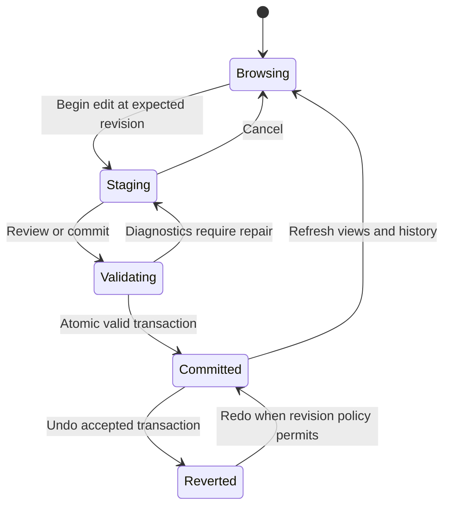
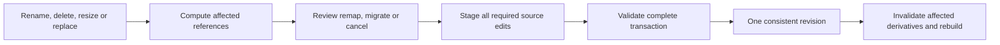

# Editor shell, transactions and interaction specification

[Blueprint index](README.md) · [Authoring workflows](../AUTHORING_WORKFLOWS.md) · [Automation contract](../AUTOMATION_AND_EXTENSION_API.md)

**Blueprint BP-SHELL, proposed.** Primary coverage: STREQ-01/18/20/21. Relevant work: STU-CORE-03/04/06/07/08 and STU-API-01/02/03/08.

## Shared workspace layout

| Region | Information/actions | Persisted where |
| --- | --- | --- |
| Project bar | Project/revision, dirty state, save/checkpoint, build and export | Project metadata/history |
| Content browser | IDs, folders/tags, type, usage, missing references and search | Project documents; optional editor layout separate |
| Primary editor | Map, pixels, timeline, graph, waveform, text or source | Selected source document |
| Inspector | Typed fields, units/defaults, references and errors | Shared edit commands |
| History/diff | Transactions, affected documents and undo/redo | Authoring history, never player progress |
| Diagnostics | Field/node/source location, severity and suggested resolution | Build/validation report |
| Preview panel | Build identity, seed, play/pause/stop, visual/audio audition | Temporary preview session |
| Status/progress | Long-operation progress, cancellation and recovery | Operation state and consistent checkpoints |

A tool switch must preserve a valid source revision and make unsaved/staged edits visible. Layout preferences are not gameplay state.

## Selection and focus model

| State | Contract |
| --- | --- |
| Document selection | Stable source ID; rename/move does not break identity |
| Subselection | Type-specific IDs: tile set, layer/cel/frame, note/clip, graph node/edge or text key |
| Multi-selection | Explicit shared-property editing; mixed values remain distinguishable |
| Inspector focus | Keyboard order and restore target are defined |
| Modal operation | Gate affected editing commands, not unrelated data reads |
| Preview focus | Runtime input is isolated from editor shortcuts |
| Lost/deleted selection | Move to a valid parent/document and explain the change |
| Agent inspection | Returns the same selection-independent source schema without relying on UI focus |

## Edit lifecycle

| Operation | Required semantics |
| --- | --- |
| Pointer gesture | Group continuous brush/drag updates into one intentional transaction |
| Numeric edit | Declare commit boundary, units and invalid-value behavior |
| Batch edit | All required changes stage together; invalid batch cannot partially commit |
| Undo | Restore authored documents/assets and reference relationships |
| Redo | Reapply a known transaction only when its history/revision preconditions hold |
| Save/checkpoint | Record an identified consistent revision; distinguish from auto recovery |
| Cancel | Discard staged edits and temporary preview output |
| Stale revision | Reject or enter an explicit merge flow; never silently overwrite |
| Long build/import | Show progress/cancel and retain the prior valid project/build identity |

Command history stores semantic operations or source deltas under a bounded disk policy. It must not accumulate every preview frame or duplicate uncompressed audio in RAM for every knob movement.

## Property-inspector contract

| Field family | Controls and validation |
| --- | --- |
| Scalar | Declared type, units, range, default and optional modulation |
| Enum | Supported values, unavailable reason and migration behavior |
| Reference | Stable ID picker, target kind, usage links and missing-target diagnostics |
| List | Stable element IDs, reorder semantics and duplicate constraints |
| Curve | Time/value units, interpolation, endpoint policy and numeric alternative |
| Formula/code | Source location, compile diagnostics and shared preview semantics |
| Color/palette | Color mode, alpha/index behavior and conversion review |
| Resource | Source/derivative distinction, hashes, codec/dimensions and provenance |

Do not expose an editor-only formula that bypasses the runtime compiler. Schema introspection must describe every supported persistent property available to automation.

## Cross-domain dependency changes

Deleting a sprite can affect animation clips, actor portraits and cues. Replacing an audio sample can affect instruments, SFX regions and loop markers. Map resizing can affect units, props, zones, objectives and camera bounds. All affected references need an explicit resolution.

## Diagnostic vocabulary

| Code family | Meaning | Required location |
| --- | --- | --- |
| EDIT-REVISION | Stale/conflicting edit | Project and expected/current revision |
| EDIT-VALUE | Invalid field/range/unit | Document and property path |
| EDIT-REFERENCE | Missing/wrong-kind target | Referencing field and target ID |
| EDIT-DEPENDENCY | Delete/replace breaks dependents | Complete affected-reference list |
| EDIT-CAPABILITY | Tool/format unavailable | Requested operation and supported alternatives |
| BUILD-SOURCE | Compile/import/asset failure | Source file/node/region |
| PREVIEW-VERSION | Preview does not match selected revision | Project/build identity |

These are proposed categories, not current error codes. Messages must explain what failed and what remains unchanged without falsely labeling the old build as newly successful.

## Accessible editing acceptance

Keyboard access must cover content selection, inspector fields, source editors, history, build/import/export and diagnostics. Provide numeric/list alternatives for map positions, pixel selections, note timing, curves and graph connections. Focus must survive dialogs, errors, tool switches and preview stop.

BP-SHELL is complete only after representative UI and API edits produce equivalent diffs and undo results, stale edits reject clearly, recovery restores a consistent revision, and preview/player saves remain isolated.

