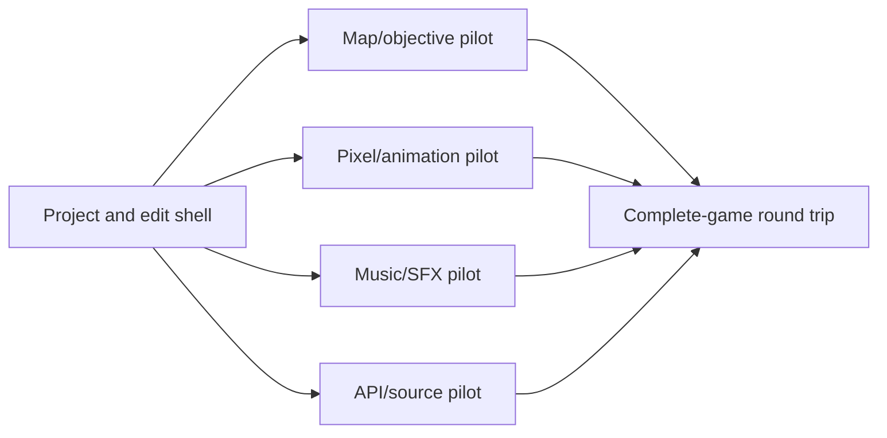

# Studio prototype implementation slices

[Blueprint index](README.md) · [Studio roadmap](../STUDIO_ROADMAP.md) · [Acceptance](../ACCEPTANCE_AND_ROUNDTRIP.md)

**Blueprint BP-SLICES, proposed bounded prototypes.** These slices refine the existing eighty work items; they do not add completed tools or replace the ten studio gates. Use them to establish shared contracts before large UI or content production.

## Slice map

| ID | Prototype | Main work | Minimum proof |
| --- | --- | --- | --- |
| STSL-01 | Canonical project and edit shell | STU-CORE-01–07 | Import current template, inspect schema, stage/undo a revision and recover |
| STSL-02 | Map/objective editor pilot | STU-MAP-01–08 | Paint an alternate board, place actors/objective and play fail/retry/win |
| STSL-03 | Pixel/animation source pilot | STU-ART-01–03, STU-ANIM-01–06 | Edit layers/frames/pivot and compile matching runtime playback |
| STSL-04 | Music/SFX graph pilot | STU-MUSIC-01–04, STU-SFX-01–06 | Compose notes and synthesize an original layered hit/miss sound |
| STSL-05 | Shared API and custom source pilot | STU-API-01–07 | Equivalent UI/API diffs and one buildable custom behavior |
| STSL-06 | Complete-game clean round trip | STU-PACK-01–08 | Play, export, clean-import, re-edit all pilot sources and rebuild |

The dependency graph is a design ordering, not a staffing plan or delivery schedule. Existing game-foundation IDs in the tooling backlog still apply.

## STSL-01 — Project and edit shell

| Field | Scope |
| --- | --- |
| Deliver | Source project identity/schema, basic browser/inspector, revisioned transactions, history and recovery |
| Start with | Current game imported as a validated template |
| Demonstrate | Read map/ability source, apply one valid/invalid batch, undo, checkpoint and reopen |
| Defer | Full authoring UI, many asset formats and arbitrary collaboration |
| Exit evidence | Baseline game equivalence; atomic rejection; stable references; no player-save mutation |

## STSL-02 — Map and objective pilot

| Field | Scope |
| --- | --- |
| Deliver | Tile/height/collision brushes, actor placement, one zone/interaction objective and exact preview |
| Start with | Approved map/roster contracts and STSL-01 |
| Demonstrate | Resize/paint, inspect references, run a seed, fail/retry/resume and settle once |
| Defer | Every biome, weather, full campaign and complex neutral AI |
| Exit evidence | Bounds/world/input agreement, shared legality and objective timing |

## STSL-03 — Pixel and animation pilot

| Field | Scope |
| --- | --- |
| Deliver | Layered indexed/RGBA source, core pixel edits, two-frame timeline, pivots and packing |
| Start with | Synthetic example document plus one deliberately imported source asset |
| Demonstrate | Paint a cel, reorder layer/frame, edit duration/pivot, compile and inspect at game scale |
| Defer | All directions/jobs, advanced painting and large external-format coverage |
| Exit evidence | Exact source identity after save/import; matching runtime registration; undo works |

## STSL-04 — Music and sound pilot

| Field | Scope |
| --- | --- |
| Deliver | Small approved DSP graph, note pattern, original impact sound, mixer bus and hit/miss cues |
| Start with | Oscillator/noise/envelope/gain/mixer/output nodes; source sample adapter if available |
| Demonstrate | Edit a note and decay, audition solo/in game, bind results, stop/mute/resume and render |
| Defer | Full workstation plugin ecosystem, every codec, voice production and large soundtrack |
| Exit evidence | Source graphs/notes retained; typed ports/clocks; declared preview/bounce/runtime parity |

Music-only playback does not finish this slice. It needs original sound-effect creation and a result-bound SFX path.

## STSL-05 — API and custom source pilot

| Field | Scope |
| --- | --- |
| Deliver | Capability/schema inspection, typed batch edits, diffs/validation and one extension/source build |
| Start with | The same command implementations used by the pilot UIs |
| Demonstrate | Map/pixel/note/SFX/rule edits through UI and agent-style commands |
| Defer | External service integrations and a broad plugin marketplace |
| Exit evidence | Equivalent source diffs; explicit unsupported operations; included buildable source |

## STSL-06 — Complete export/reimport pilot

| Field | Scope |
| --- | --- |
| Deliver | Default complete-game artifact plus separate project/runtime-only profiles |
| Start with | All pilot source documents and a real shared runtime build |
| Demonstrate | Supported launch, clean import without original caches, cross-domain re-edit and rebuild |
| Defer | Extra platforms, unapproved offline policy and additional package adapters |
| Exit evidence | Actual source/asset hashes, readable build report, playable route and preserved rich sources |

## Evidence package

| Evidence | Required identity |
| --- | --- |
| Source/command diff | Project ID, base/result revision and affected document IDs |
| Runtime result | Build ID, engine/API/toolchain version, seed and scenario |
| Art/audio proof | Exact source/derivative identity and declared device/render settings |
| Round-trip comparison | Imported artifact/profile and normalized fields compared |
| Failure test | Invalid input, diagnostic and unchanged prior revision |
| Remaining limits | Explicit deferred tools/formats and unsupported targets |

The small examples in this documentation are schema probes. They are not a substitute for these executable prototype exits.

