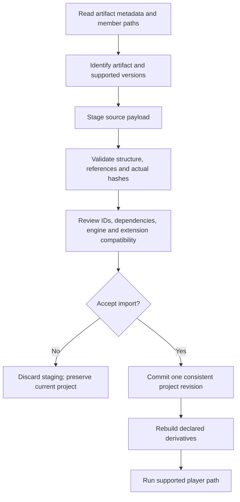

# Project import and playable export conformance

[Blueprint index](README.md) · [Project/artifact contract](../PROJECT_FORMAT.md) · [Build pipeline](../RUNTIME_BUILD_EXPORT.md)

**Blueprint BP-PACK, proposed.** Coverage: STREQ-01/19/22/23/24. These checks define a future product contract. The example manifest is not a generated game archive.

## Default complete-game payload

| Required family | Purpose | Source/editing guarantee |
| --- | --- | --- |
| Player runtime | Launchable static game, content, art and audio | Play without the authoring application |
| Editable project | Canonical document and asset graph | Reopen stable IDs and full authored relationships |
| Rich masters | Pixel layers/cels, notes/arrangements, sound graphs, recordings and source geometry | Re-edit sources, not only flattened outputs |
| Custom code/extensions | Source/API manifests and engine overrides | Rebuild and change custom behavior |
| Matching engine/build sources | Engine source, build scripts and dependency locks | Reproduce the approved runtime |
| Build report | Inputs, outputs, hashes, capabilities and validation scope | Identify actual revision and unsupported checks |
| Launch/edit instructions | Supported local/static path and compatible studio format | No hidden original-workspace dependency |
| Provenance/notices | Source/rights and processing inventory | Preserve required attribution/terms |

[Bundle example](../specs/examples/bundle.json) lists conceptual members and roles. It intentionally has a not-built status and no fabricated file hashes.

## Artifact guarantees

| Profile | Valid claim | Invalid claim |
| --- | --- | --- |
| Editable project | Whole-project source round trip within supported format | Already playable without build/runtime |
| Complete game | Playable output plus editable payload and buildable source | Proof of clean import before it is actually tested |
| Runtime-only | Playable distribution with declared launch path | Recovery of absent original layers/notes/custom source |
| Asset pack | Selected sources/dependencies and reviewed remap | Entire game/quest/save completeness |
| Player save | Progress for a compatible game | Editable authoring project |
| Source export | Buildable sources/locks and original authored assets | Precompiled runtime when none was built |

## Import stages

Archive parsing and compatibility review occur before project replacement. Imported executable source is preserved as source and activated through the explicit extension/build workflow.

## Path and membership rules

| Condition | Future importer behavior |
| --- | --- |
| Absolute/outside-root path | Reject |
| Parent traversal or ambiguous normalized path | Reject |
| Duplicate normalized member | Reject or require an explicit supported mapping; never silently shadow |
| Referenced missing member | Report referencing source and missing target |
| Required file hash mismatch | Reject the affected package/revision |
| Unexpected optional metadata | Preserve when supported; do not treat it as executable behavior |
| Missing rich source in runtime-only mode | Allow declared limited import; disclose lost editing guarantees |
| Missing rich source in complete mode | Fail conformance; do not silently relabel as complete |

Limits for archive size, file count, decompression ratio, audio/image dimensions and code dependencies require measured product policies. Validate real bytes when an importer exists; static example member checks are not that implementation.

## Revision, identity and save handling

| Scenario | Required result |
| --- | --- |
| Import into empty studio | Preserve project/content identity and compatible source documents |
| Import over existing project | Staged review and explicit replace/fork/merge |
| Fork | New project identity with deliberate content/remap/save policy |
| Engine mismatch | Supported migration or actionable compatibility rejection |
| Player save from another project/build | Explicit compatibility check; no silent attachment |
| Unsupported future schema | Preserve archive and existing workspace; identify required version |
| Crash during import | Recover old consistent revision or accepted new one, not a partial mix |

## Export proof steps

1. Validate the selected committed revision and dependency closure.
2. Build runtime and derivatives through the same pipeline as preview.
3. Record toolchain/input/output identity and actual validation results.
4. Include the exact artifact profile's required sources and members.
5. Validate actual member paths, file hashes and launch instructions.
6. Open the playable output through the supported local/static host path.
7. Import the complete bundle in a clean compatible studio without original caches.
8. Compare canonical source identity and make new cross-domain edits.
9. Rebuild and repeat the player path.

## Failure matrix

| Failure | Required diagnostic/evidence |
| --- | --- |
| Corrupt/truncated artifact | Parse failure with original project intact |
| Missing atlas or required SFX source | Source reference and required dependency named |
| Unsupported audio codec/DSP node | Capability/adapter report, no silent empty audio |
| Lost pixel layer or note data | Round-trip comparison fails even if runtime still plays |
| Custom engine source absent | Complete/source profile fails declared rebuild guarantee |
| Old build exported after edit failure | Revision mismatch explicitly reported; no false success |
| Relative path breaks on Pages | Root/subpath launch smoke check fails before certification |
| Incompatible offline update | Activation/rollback/save policy exercised explicitly |

The [golden round-trip guide](../ACCEPTANCE_AND_ROUNDTRIP.md) remains the product acceptance authority. This blueprint makes its import/export evidence concrete.

