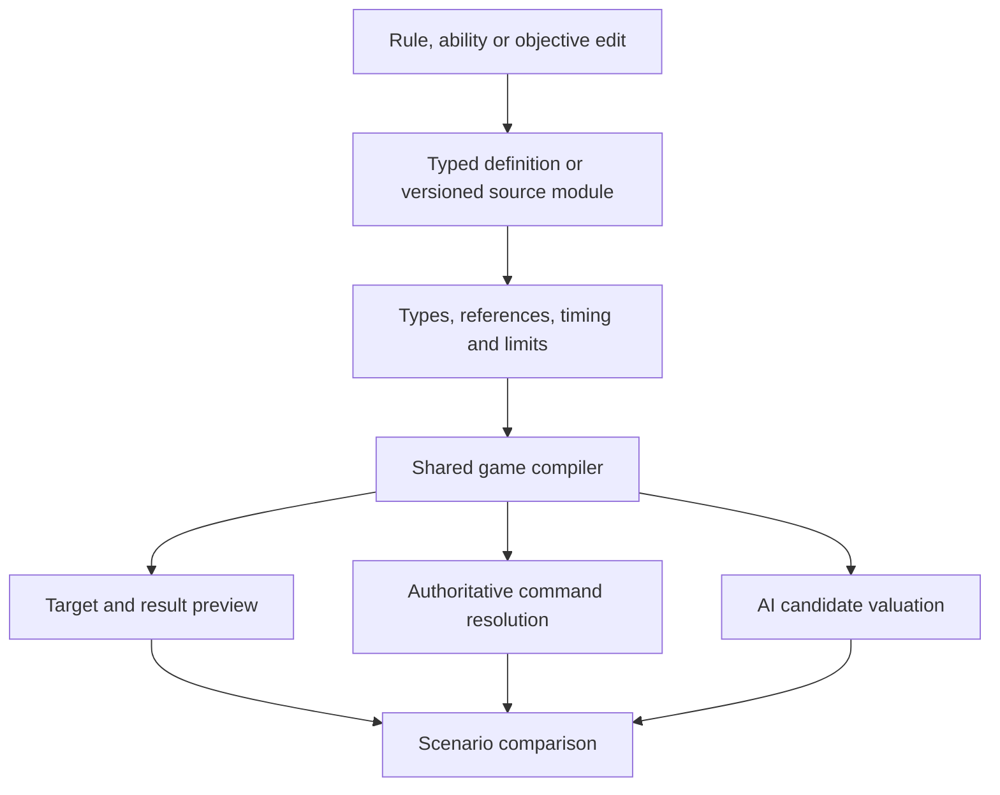

# Level, rules and game-system editor specification

[Blueprint index](README.md) · [Editor workflows](../AUTHORING_WORKFLOWS.md) · [Technical proposals](../../roadmap/TECHNICAL_CONTRACTS.md)

**Blueprint BP-LEVEL, proposed.** Coverage includes STREQ-02–09/18/19/21/24. The existing game uses fixed source-defined content; these editors are planned authoring surfaces.

## Level authoring model

| Layer | Operations | Shared validation |
| --- | --- | --- |
| Dimensions/tiles | Resize, paint terrain/elevation, fill and select regions | Complete coordinate coverage, legal ranges and stable tile identity |
| Collision/navigation | Block/unblock, footprint and route probes | Rule occupancy agrees with visual placement |
| Props | Place/clone/rotate/scale, material/light and collision editing | Source asset references, valid footprints and interaction state |
| Zones | Deployment, exits, capture areas, reinforcement entries and audio regions | Existing cells, explicit overlap/occupancy policy |
| Actors | Place allied/enemy/neutral/summon templates | Stable unit IDs, template references and simulation order |
| Objectives | Counters, success/failure, interactions and optional goals | Approved timing and terminal precedence |
| Environment | Lighting, materials, camera fit, ambience and VFX placement | Readability plus runtime-target/resource capability |
| Preview | Select tile/entity, path/range/LOS and objective inspector | Same compiled map/rules used by exported game |

The [level example](../specs/examples/level.json) is an illustrative small board with complete cells, two units, one zone and an interaction objective. It is not a new playable encounter.

## Inspector and gesture examples

| Action | UI path | API/command path | Invalid path |
| --- | --- | --- | --- |
| Raise tiles | Select region → height field/brush | map.setTile/map.paintRegion | Reject/migrate affected units/props explicitly |
| Place actor | Template browser → deployment preview | encounter.placeUnit | Occupied/blocked/wrong-zone cell identifies the reason |
| Resize map | Dimensions dialog → affected-reference review | map.resize | No silent deletion of required objective cells |
| Add wave | Wave timeline/graph → entries and trigger | encounter.addWave | Missing spawn IDs or duplicate wave identity reject |
| Change objective | Goal graph → predicates/timing | objective.setDefinition | Simultaneous success/failure policy must be explicit |
| Edit collision | Prop footprint overlay + inspector | prefab.setCollision | Rule/render disagreement appears in diagnostics |

## Rule authoring

| Tool | Required source model | Preview/execution contract |
| --- | --- | --- |
| Formula editor | Typed expression/approved code module with declared inputs | One authoritative evaluator for preview and resolution |
| Ability editor | Cost, targeting, shape, effect graph, ownership and presentation references | Invalid commands reject before spending |
| Status editor | Duration unit, stacking, cleanse, triggers and expiry | Defined event boundary; no per-frame gameplay tick |
| Reaction editor | Eligibility, costs, ordering and chain limit | Lethal and recursive cases terminate predictably |
| Difficulty profile | Disclosed numeric/behavior overrides | Build/save identity records the selected profile |
| Custom mechanic | Versioned extension/source hook | Compile diagnostics, deterministic scenarios and exportable source |

A free-form formula field must not evaluate arbitrary text through an undocumented UI-only path. The source model should be a typed expression tree or a declared extension compiled through the shared build pipeline.

## Other game-system editors

| Domain | Core editing controls | Failure/acceptance examples |
| --- | --- | --- |
| Jobs/boards | Nodes, costs, prerequisites, native/learned/support slots | Cycles, duplicate ownership and unavailable proficiency |
| Actors/AI | Base stats, roles, loadouts, summons and scoring/behavior | No legal move/target, blocked spawn and finite planning budget |
| Economy | Gear, stack rules, shops, recipes, loot and settlement | Cost/output atomicity and unique reward deduplication |
| Campaign/quests | Route graph, flags, conditions, factions, recruits and endings | Required reachability and branch convergence |
| Dialogue/codex | Speakers, choices, conditions, text keys and portrait/voice references | Cancel does not commit; localization overflow/missing keys |
| UI/controls | Title/HUD/menu layouts, themes, fonts, input actions and accessibility defaults | Full keyboard/pointer/touch/controller path through the authored game |

## Objective and trigger contract

| Property | Required decision |
| --- | --- |
| Trigger identity | Stable ID, cause/event reference and one-shot/repeat policy |
| Timing | Legal command, completed activation, objective tick or approved explicit boundary |
| Saved state | Progress, pending work, consumed IDs and terminal cause |
| Condition | Typed inputs and target references; explicit AND/OR semantics |
| Action | Approved spawn/interact/status/quest/reward operation with bounds |
| Recurrence | Explicit finite/bounded state behavior; distinguish a state-machine loop from unbounded execution |
| Terminal precedence | Approved simultaneous success/failure ordering |
| Presentation | Warning versus resolved result, UI text and audio/VFX binding |

No wave, reward or quest mutation is driven by animation completion or an editor preview timer. Changing a trigger requires validation of existing saved state/migrations before publishing to players.

## Runtime edit-preview loop

1. Stage a map/rule/content edit at a named revision.
2. Review changed sources and affected references.
3. Validate and compile the candidate through the runtime pipeline.
4. Start a mission or full-game preview with explicit seed/roster/profile.
5. Inspect path/target previews, actual outcomes, AI decisions and diagnostics.
6. Stop preview, commit/revise source and preserve independent player saves.
7. Export/reimport and confirm authored definitions remain editable.

## Acceptance boundary

Static example checks can detect bad cells, references, order, graph connections and basic reachability. They cannot certify that a mission is fair, that arbitrary custom code terminates, or that a branch is narratively coherent. Those require the linked scenario, runtime, device and authored review gates.

