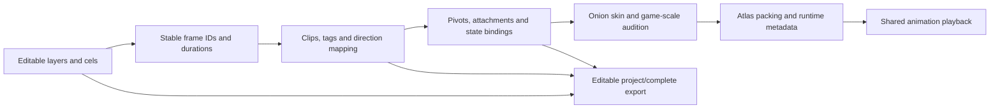

# Pixel-art and animation editor specification

[Blueprint index](README.md) · [Source preservation](../PROJECT_FORMAT.md) · [Animation pipeline today](../../ANIMATION_PIPELINE.md)

**Blueprint BP-PIXEL, proposed.** Coverage: STREQ-10/11/12/20/22. Work: STU-ART-01–08, STU-ANIM-01–08 and STU-API-04.

## Source document

| Entity | Required fields/relationships | Invariant |
| --- | --- | --- |
| Document | ID, width/height, color mode, palette/source pixel encoding | Positive dimensions; declared transparent semantics |
| Layer | Stable ID, order, visibility, opacity and blend | Every frame/cel reference resolves |
| Frame | Stable ID, duration and cels | Duration is positive; reorder changes sequence, not identity |
| Cel | Layer/frame relationship and source pixel payload | Pixel count/encoding matches document dimensions |
| Palette | Stable entries or indexed colors with transparent index | Every source index resolves |
| Clip/tag | Ordered frame IDs, loop policy, state and direction | No missing frames; explicit one-shot/final-hold behavior |
| Registration | Pivot/feet, attachments and optional hit/interaction markers | Units and allowed bounds are explicit |
| Provenance | Source/import settings, author/generation notes and transforms | Master never silently replaced by a packed derivative |

The [pixel example](../specs/examples/pixels.json) is a tiny synthetic indexed document for schema discussion, not a new character asset.

## Tool operations

| Tool group | Required behavior | Transaction boundary |
| --- | --- | --- |
| Brush/eraser | Pixel-accurate coordinates, size, alpha/index and optional symmetry | One intentional stroke |
| Fill/shape | Contiguous/global fill and pixel line/rectangle/ellipse policies | One accepted operation |
| Selection | Rectangular/freeform, add/subtract, copy/cut/paste and move | Explicit selection transform/commit |
| Transform | Flip, rotate, resize and translate with defined pixel sampling | Review changed pixels/canvas bounds |
| Layers | Create/clone/reorder/group, opacity/visibility and merge | Source-aware operation with undo |
| Palette | Add/edit/reorder/remap and indexed/RGBA conversion | Review every affected source index |
| Frames/cels | Add/clone/delete/reorder and duration | Stable IDs retained; references updated |
| Tiles | Extract, edit and place reusable tiles with terrain tags | Source tile identity separate from map placement |

Indexed palette reorder must remap indices or intentionally change their meanings through an explicit operation. A palette edit is not allowed to make existing pixels silently point at a different color.

## Animation timeline

| Control | Contract |
| --- | --- |
| Playback | Play/pause/step at declared source durations; show actual frame/time |
| Onion skin | Previous/next cel count, opacity and palette; never modifies source |
| Contact markers | Distinguish cosmetic timing markers from authoritative rules |
| Direction preview | Show world-facing convention versus camera orientation |
| Pivot overlay | Numeric editing plus visual drag; track foot drift across frames |
| Loop comparison | Inspect last-to-first registration and silhouette discontinuity |
| Down/revive | Hold final downed frame and restore correct living state |
| Reduced motion | Audition representative stable poses using runtime policy |
| Attachment preview | Weapon/effect marker follows source pivot/direction without duplicate movement |

## Atlas build contract

| Input/output | Requirement |
| --- | --- |
| Inputs | Source documents, clips, directions, pivots, packing settings and compiler version |
| Packing | Padding/extrusion and UV edge policy are explicit |
| Runtime data | Frame rectangles, durations, pivot/attachment values and state/direction mapping |
| Derivative hash | Identify compiled output separately from original source pixels |
| Registration | Preview uses the same compiled mapping as export |
| Failure | Missing frames/palette indices or invalid bounds reject before runtime |
| Rebuild | Source edits invalidate only affected derivatives and dependent previews |

Packing may rotate/trim frames only when runtime metadata and source reconstruction remain correct. Packed frame coordinates are not the authoring source.

## Import and round trip

| Input | Editing guarantee |
| --- | --- |
| Native layered document | Preserve layers/cels/palette/timing/registration |
| Flattened PNG | One flattened source layer; prior artist layers are unknown |
| Spritesheet | Review grid/rectangle/frame/direction mapping before creating source frames |
| Supported external layered format | Adapter declares preserved/lost features and mapping |
| Runtime-only atlas | Recover supported rectangles/pixels; no claim of original layers or timing beyond metadata |
| Complete-game bundle | Restore native source documents and re-edit without original workspace |

## Edge-case acceptance

| Case | Expected result |
| --- | --- |
| Delete referenced frame | Review remap/cancel; clip never retains a dangling ID |
| Crop canvas around pivot | Review coordinate migration and affected attachments |
| Zero duration or invalid source index | Field/cel-specific diagnostic |
| Hidden layer | Preserved in editable export even when omitted from compiled image |
| Duplicate/reorder frame | Stable frame identity and deliberate clip ordering |
| Undo palette remap | Restore both palette and affected pixel indices |
| Source/export/import comparison | Exact source pixel/cel/palette identity and normalized timeline data |
| Agent edit | Batched pixel/layer/frame operations reach the same source as UI tools |

Environment/model tools also need source geometry/material/UV/collision workflows. Their first implementation can be bounded modular primitives and imported editable assets; complex custom behavior remains available through source/extension editing.

