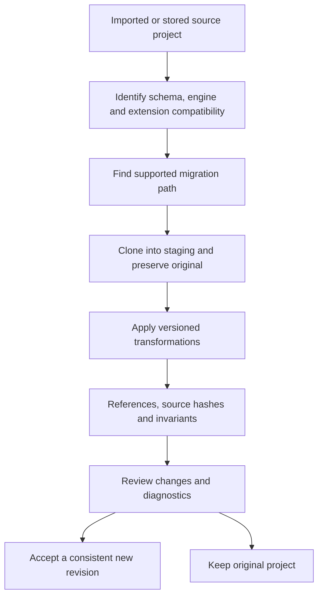
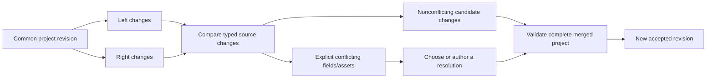

# Project versions, recovery, merges and compatibility

[Blueprint library](README.md) · [Project format](../PROJECT_FORMAT.md) · [Import/export](IMPORT_EXPORT_CONFORMANCE.md)

**Blueprint BP-VERSION, proposed.** Coverage: STREQ-01/19/20/22/23/24. This is a future editor/project contract. Current browser save behavior remains documented in [data and saves](../../DATA_AND_SAVES.md).

## Independent version domains

| Version/identity | Owns | Must not be confused with |
| --- | --- | --- |
| Project schema | Editable document structure | Engine runtime version |
| Extension API | Hook/node/inspector compatibility | Project revision |
| Engine/source lock | Code/compiler dependencies | Player-save format |
| Asset/DSP compiler | Derivative semantics and reproducibility | Original master identity |
| Revision | Authoring edit history | Combat activation counter |
| Build ID | Compiled output/input identity | Current dirty editor state |
| Player-save schema/content ID | Progress restoration | Project import/archive version |
| Local editor-store schema | Workspace recovery/storage layout | Any of the above |

Do not automatically bump every version together. Record why an incompatible shape or semantic change needs migration.

## Project migration workflow

| Migration requirement | Evidence |
| --- | --- |
| Explicit path | Supported from/to versions and ordered transformations |
| Source preservation | Original masters and project package remain available |
| Stable identity | ID aliases/remaps and deleted-content policy are explicit |
| Determinism | Same source/version path yields equivalent normalized result |
| Failure | Atomic staging; no partially upgraded workspace |
| Code activation | Extension/source compatibility review before build/execution |
| Player saves | Separate migration/compatibility decision for progress |
| Downgrade | Supported adapter or clear rejection, not speculative reverse conversion |

The [version/merge example](../specs/advanced/version-merge.json) describes synthetic migration edges and field conflicts. Checking the edge graph is not executing a migration.

## Authoring recovery

| State | Expected recovery |
| --- | --- |
| Committed project revision | Reopen exact sources and metadata |
| Staged transaction | Recover as a reviewable candidate or discard consistently |
| Long import/build/bounce | Prior project/build remains identifiable; partial outputs are not successful artifacts |
| Corrupt current editor record | Try declared prior-valid checkpoint; report recovery |
| Full disk/quota | Show failure and retain previous valid state; do not claim saved |
| Multiple tabs/processes | Detect revisions/ownership and refuse stale silent overwrite |
| Playtest progress | Separate namespace and explicit restore/reset |
| Imported player save | Validate against selected compatible game, not arbitrary editor project |

## Merge model

| Change | Candidate policy |
| --- | --- |
| Disjoint typed fields | Merge when base/revisions and references remain valid |
| Same field changed identically | Coalesce deliberately |
| Same field changed differently | Explicit conflict with base/left/right values |
| Delete versus edit | Conflict; show affected references |
| List reorder | Stable element IDs and semantic order policy |
| Pixel/source regions | Merge only through an approved domain-aware method; preserve both originals otherwise |
| Audio recording/binary source | Explicit source selection or a domain edit; no guessed byte merge |
| Custom code | Source diff/merge plus compile/scenario validation |
| Engine/schema mismatch | Resolve compatibility before source merge |

This is a future three-way merge contract, not implemented real-time collaboration. Cloud accounts/synchronization require separate explicit scope and operational decisions.

## Publishing and save compatibility

| Change type | Required review |
| --- | --- |
| Text/theme/optional cue | Check stable references and whether progress semantics change |
| Formula/stat change | Existing battle/resource/difficulty impact and build identity |
| Removed item/job/quest | Alias/migration or explicit unsupported restore |
| Map/roster/objective shape | Coordinate, identity, pending-state and terminal behavior migration |
| Audio/animation compiler change | Source preservation and derivative parity; gameplay clock stays independent |
| Engine override | Rebuildable source and supported-save fixture evidence |
| Offline cached update | New build activation, old chunks/assets, export/recovery and rollback |

A compatible project import does not automatically make every player save compatible. Editor restore/undo does not rewrite published-game progress.

## Acceptance

Restore a project checkpoint, reject a stale edit, merge disjoint changes, resolve a same-field conflict, preserve conflicting masters, rehearse a failed migration and reject an unsupported downgrade. Build and export from the accepted revision; verify that both source and player-save compatibility claims match evidence.

