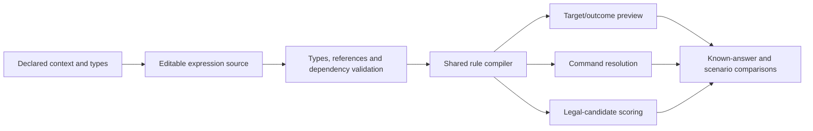

# Rules, statuses, reactions and AI authoring

[Blueprint library](README.md) · [Level editor](LEVEL_AND_RULES_EDITORS.md) · [Runtime boundary](../../adr/0002-deterministic-simulation-boundary.md)

**Blueprint BP-RULES, proposed.** This defines a future authoring surface, not a replacement for current engine.ts. Coverage: STREQ-04/05/06/19/20/21. Examples use synthetic rules and are not balance values or supported imports.

## Rule editor source model

| Source | Authoring operations | Required constraint |
| --- | --- | --- |
| Formula | Typed input/constant/expression tree; named intermediate expressions | One evaluator shared by preview and resolution |
| Targeting | Range, LOS, shape, faction, occupancy and eligibility | Preview and command rejection use the same contract |
| Status | Clock, duration, stacks, cleanse, modifiers and triggers | Named event boundary; no render-frame tick |
| Reaction | Eligibility, costs, ordering, scope and limits | Bounded causal chain with lethal cases defined |
| Difficulty | Data/rule overrides and AI profile | Disclosed changes, build/save identity and migration policy |
| AI score | Legal candidate inputs, weighted expressions and stable ordering | Scoring cannot bypass legality or consume combat RNG |
| Extension | Versioned code module and declared hooks | Buildable source, diagnostics and scenario evidence |

The [rule example](../specs/advanced/rules.json) uses a small typed arithmetic vocabulary with reference checks and known-answer calculations. The documentation checker evaluates those arithmetic examples only; it is not a gameplay engine.

## Typed expression contract

| Operation family | Inputs/output | Editor behavior |
| --- | --- | --- |
| Literal/input | Declared number or boolean | Show source, units and read-only input identity |
| Named reference | Previously declared expression type | Dependency/usage navigation; reject cycles |
| Arithmetic | Numeric operands → number | Range/zero-domain warnings where relevant |
| Comparison/logical | Approved operands → boolean | Compatible port/field types only |
| Conditional | Boolean condition, matching branch types | Both branches type-check, even if one is not selected |
| Clamp/round | Explicit numeric policy | Preview shows the chosen rounding boundary |
| Seeded chance | Approved runtime hook with draw policy | No implicit random nodes in preview or AI score |
| Code extension | Explicit module/API | Separate compile/activation state; no hidden eval text |

A formula source must not contain browser globals, wall-clock input or an undocumented random source. Arbitrary custom code needs a broader review contract; a typed graph alone cannot prove every extension deterministic.

## Authoring flow

## Ability and progression inspectors

| Inspector | Required fields | Failure cases |
| --- | --- | --- |
| Ability | Costs, target, shape, formula/effect, ownership and cue references | Unknown graph, invalid resource, missing target policy |
| Job | Identity, base stats, proficiency and native skills | Dangling skills and incompatible starting loadout |
| Skill board | Stable nodes, prerequisites, costs and unlocks | Cycles, overspent JP and unreachable required learning |
| Support | Slot, source job, ownership and modifiers/reaction | Wrong slot, unlearned equip and recursive effects |
| Difficulty | Override scope, values and selected profile ID | Undisclosed rule changes or incompatible restore |

Keep permanent learning distinct from current native access. A source edit can change future progression; migration must state how existing learned IDs and spent resources are retained.

## Status/reaction timing

| Question | Required answer before implementation |
| --- | --- |
| Duration unit | Whose activation, completed activation, objective tick or another approved boundary? |
| Stack policy | Replace, maximum duration, additive count or bounded independent instances? |
| Apply/cleanse order | Which event can remove or transform a status and when? |
| Source attribution | Which actor/effect caused transferred or periodic damage? |
| Reaction scope | Direct hit only, surviving hit, hazard, counter or transferred damage? |
| Limits | Maximum causal depth/events and repeated-target/source policy? |
| Lethal order | Does defeat stop remaining triggers; when are objectives evaluated? |
| Save/load | Which pending facts persist and which historical visuals are suppressed? |

Do not solve infinite reactions by silently dropping authoritative damage. Reject invalid content or implement an explicit approved rule limit; cosmetic queue dropping is a different policy.

## AI inspector

| View | Information |
| --- | --- |
| Legal candidates | Actor, destination/target, action, costs and rejection reason |
| Score breakdown | Named expression terms and evaluated context |
| Ordering | Stable unit/tile/action tie-break and approved iteration |
| Budget | Candidate/depth/time policy with deterministic fallback |
| Outcome | Chosen legal command and actual resolved state |
| Scenario | Seed, loadout, objective, source revision and build identity |

Preview/AI evaluation should not advance the combat seed. A chosen action calls the same authoritative command path as the player.

## Acceptance

Edit an ability and status through UI/API, compare preview to resolution, run a lethal reaction and no-legal-action AI case, reload pending state and export/reimport the source. Known-answer arithmetic is necessary evidence for a formula, but not proof of balance, complete targeting or arbitrary extension safety.

