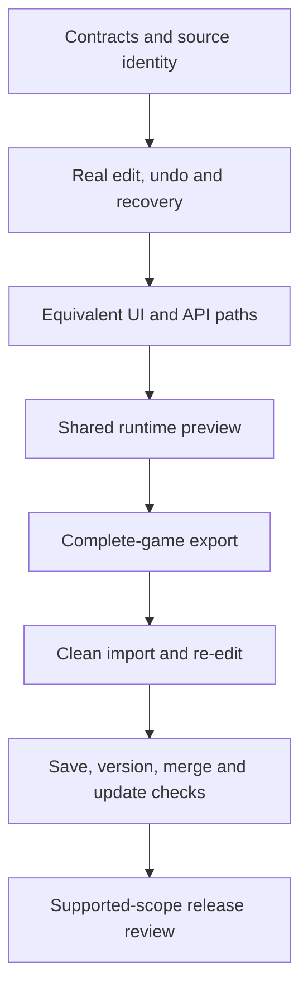

# Toolkit release plan and implementation handoff

[Blueprint library](README.md) · [Studio gates](../STUDIO_ROADMAP.md) · [Prototype slices](IMPLEMENTATION_SLICES.md) · [Golden acceptance](../ACCEPTANCE_AND_ROUNDTRIP.md)

**Blueprint BP-RELEASE, proposed.** This organizes delivery evidence for the existing eighty tooling items and thirty-two acceptance scenarios. It adds no calendar, staffing promise or implemented tools.

## Release layers

| Layer | Purpose | Exit evidence | Explicit deferrals allowed |
| --- | --- | --- | --- |
| R0 — Contract probes | Validate schemas/examples and current-game adapter assumptions | Types/references, known-answer examples and baseline fixtures | Full editing UI, audio renderer and distribution |
| R1 — Cross-domain prototype | One real edit in map/rules, pixels/animation and music/SFX through shared transactions | Exact playable preview and source retention | Broad format adapters and all advanced editor functions |
| R2 — Complete small-game alpha | Author a small complete title-to-ending game and default complete bundle | Clean import, re-edit and rebuild without original workspace | More content, advanced plugins and broad device matrix |
| R3 — Workflow beta | Expand usable tools, diagnostics, recovery, accessibility and compatibility | Full stated control paths, negative/failure coverage and measured budgets | Unsupported targets/features explicitly listed |
| R4 — Authoring release candidate | Certify selected scope and artifact guarantees | Golden project, restore/merge/update/rollback and source/provenance review | Only declared nonessential deferrals |

R0 documentation checks do not satisfy R1. A runtime-only build does not satisfy R2's complete editable-source guarantee.

## Handoff package per work item

| Artifact | Required information |
| --- | --- |
| Scope | STU/STREQ/STAC/BP IDs and a bounded player/author path |
| Contract | Source schema, units, identities, references and migration/defaults |
| UI/API behavior | Real controls plus equivalent typed operations |
| Invalid path | Rejection/cancel/conflict diagnostics and unchanged prior state |
| Undo/recovery | Transaction boundary, stored deltas and checkpoint behavior |
| Runtime integration | Exact compiler/runtime input and preview/export parity |
| Export/import | Rich sources and required artifact dependencies |
| Evidence | Revision/build/seed/toolchain/device identity and actual checks |
| Limits | Unsupported formats/targets and explicit deferrals |
| Docs | Current behavior updated only after implementation |

## Scope for the first usable alpha

| Domain | Minimum meaningful capability |
| --- | --- |
| Workspace | Create/open/recover, inspect references, undo/redo and revision checks |
| Levels/missions | Paint heights/collision, place units/objectives and play an alternate mission |
| Rules/content | Edit supported formulas/abilities/builds and a simple campaign/dialogue route |
| Visual sources | Layered pixel edits, frame timing/pivot and compiled runtime playback |
| Audio | Notes/instrument/arrangement plus original layered SFX, mixer and result bindings |
| Effects/environment | One editable effect/particle graph and prefab/material path |
| UI/control | Editable menu/HUD/settings and supported complete navigation |
| Extensions | One source-level custom behavior with reproducible export |
| Distribution | Default complete bundle, project source and separately labeled runtime-only build |
| Clean round trip | Reopen sources and edit again; no original cache/repository dependency |

A small alpha can use limited approved node/tool vocabularies. It still needs every domain required by the golden project; a music player or map viewer alone is not a game-authoring product.

## Evidence dependency graph

## Release evidence matrix

| Concern | Required proof | Block when |
| --- | --- | --- |
| Source loss | Compare pixels/layers, notes, graphs, PCM/code and references | Rich sources missing from a claimed complete artifact |
| Preview drift | Same approved compilation/scheduling semantics | Editor and exported game disagree |
| Broken tools | Actual UI/API edits with undo | A core operation exists only in mockups/private state |
| False success | Build/artifact identity and actual test results | Old build labeled as containing failed edits |
| Audio | Audition, render parity, loops/mix/cues, mute and recovery | Required SFX/music silently absent or sources flattened |
| Persistence | Project/player-save isolation, conflict/migration and rollback | Progress/source loss or silent overwrite |
| Accessibility | Supported editing and game control paths | Required actions unreachable in supported mode |
| Performance | Measured representative device/scene/assets | Limits are unknown but advertised as certified |
| Distribution | Actual root/subpath/local launch and dependency closure | Editor/server/original workspace unexpectedly required |
| Provenance | Source/rights/processing inventory and explicit license decision | Distribution claims exceed recorded rights |

## Definition of done for planning versus implementation

| Label | Meaning |
| --- | --- |
| Blueprint checked | References, example constraints and diagrams are internally consistent |
| Prototype implemented | Real controls/commands produce source edits and actual output |
| Runtime integrated | Shared preview/export player consumes approved compiled data |
| Round-trip proven | Clean import preserves rich sources and supports new edits/rebuild |
| Release certified | Selected workflow/device/version/distribution claims have evidence |

Only the first label can result from this documentation update. The other labels require the future tooling work and its evidence.

