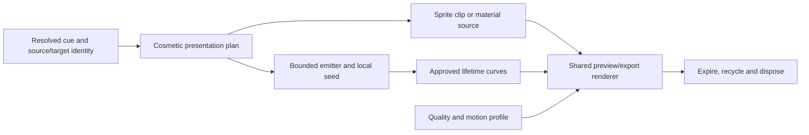

# VFX, materials, prefabs and environment authoring

[Blueprint library](README.md) · [Pixel/animation sources](PIXEL_ANIMATION_EDITOR.md) · [Current effects](../../COMBAT_EFFECTS.md)

**Blueprint BP-PRESENT, proposed.** Coverage: STREQ-02/11/12/13/17/18/20/22. Source graphs and inspector operations are planned, not a new renderer implementation.

## Presentation source families

| Source | Authoring controls | Runtime/round-trip contract |
| --- | --- | --- |
| Sprite/VFX clip | Frame source, timing, pivot, blend, color and size | Rich clip source retained; compiled mapping matches preview |
| Emitter | Count/rate/burst, lifetime, shape, speed and seed | Bounded local cosmetic simulation |
| Curves | Time/color/scale/opacity/velocity and interpolation | Declared normalized units and endpoint behavior |
| Trail/projectile | Anchors, path/arc, attachment and contact policy | Tracks presentation positions without changing rules |
| Material | Color/textures, roughness/metalness/opacity and supported shader features | Target capability and fallback declared |
| Geometry/prefab | Primitive/imported mesh, transform, UV/material and collision | Source identity separate from optimized derivative |
| Environment | Light/sky/fog/camera profile, terrain and ambience | Readability plus measured resource policy |
| Cue | Resolved event/result/phase and source graph | Deduplication and reduced-motion/intensity alternative |

The [presentation example](../specs/advanced/presentation.json) references existing synthetic source IDs and a proposed prefab. It is checked as data; no image, shader or particle system is rendered.

## Effect graph contract

| Parameter | Required semantics |
| --- | --- |
| Lifetime | Positive explicit milliseconds/seconds, not unspecified frames |
| Count/rate | Finite values and quality-profile scaling policy |
| Seed | Cosmetic source; never a combat RNG draw |
| Position | Declared local/world/tile space and anchor |
| Curve time | Normalized lifetime or explicit timeline; no hidden mixed units |
| Bounds | Culling/extent policy and overflow diagnostics |
| Pool | Per-effect/global limits and deterministic visual dropping policy |
| On load | Historical one-shots suppressed; approved persistent aura state reconstructed |
| Motion alternative | Static/low-intensity source and consistent gameplay meaning |

Dropping a particle is an approved cosmetic degradation; dropping a gameplay reaction is not.

## Curves and graph editing

| Tool | Required behavior |
| --- | --- |
| Curve editor | Add/reorder points, numeric time/value fields, interpolation and endpoint preview |
| Anchor picker | Source/target/attachment selection with valid-reference checks |
| Layer stack | Stable IDs, order, blend and enabled state |
| Budget view | Estimated counts/bytes plus measured scene results |
| Camera review | Rotate/zoom through supported views and inspect depth/readability |
| Low-quality preview | Apply actual compiled profile, not a misleading thumbnail |
| Source audition | Pause/step and inspect timing without altering battle state |
| Automation | Same graph/curve/anchor operations and diagnostics as UI |

## Material and prefab inspector

| Area | Contract |
| --- | --- |
| Material types | Supported built-in model and explicit extension version for custom shaders |
| Texture slots | Source reference, color-space/sampling policy and derivative settings |
| Geometry | Primitive/blockout or imported editable source; bounded vertex/face/UV operations |
| Transform | Position/rotation/scale with units, pivot and snapping |
| Collision | Rule footprint/interaction state separate from decorative geometry |
| Attachment | Named markers and compatible actor/prop/source spaces |
| Lighting | Intensity/color/range and shadow/quality policy |
| Audio | Ambience/emitter reference and shared cue/mix contract |
| Optimization | Rebuildable target-specific derivatives; masters preserved |

A visible wall should not imply a blocker the rules do not contain; a rule blocker needs a readable visual. Collision edits must participate in map/reference validation and undo.

## Quality and lifecycle

| Scenario | Acceptance |
| --- | --- |
| Many overlapping effects | Declared caps/recycling; measured scene/device context |
| Missing source/unsupported shader | Explicit fallback or required-build diagnostic |
| Camera/actor movement | Correct shared transform and anchor |
| Status cleanse/revive | Aura/attachment clears or returns according to state |
| Scene switch/dispose | Timers, geometry, maps, materials and audio emitters release |
| Low motion/intensity | Core meaning retained through shape/text/static cues |
| Export/reimport | Graphs, curves, source geometry/material and bindings remain editable |
| Custom extension | Source/API/toolchain included with target capability evidence |

## Acceptance

Create a particle/contact effect, one material/prefab and an environment profile; bind them to a mission, change their sources through UI/API, preview caps/motion/fallback and export/reimport. Static curve validation cannot certify frame rate, visual clarity or resource cleanup; those require actual prototype/device evidence.

